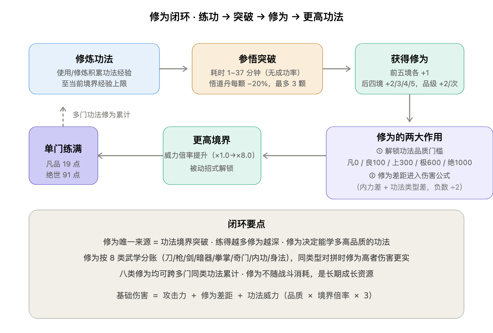

# 修为系统

> **本轮修订（v0.8）**：修为**获取方式改为「武学突破产出」制**——只有通过**武功境界突破**才能获得对应修为（原「使用武功 / 学习功法 / 门派指点 / 奇遇顿悟 / 残页研读」等途径**取消**）；同时修为成为**伤害公式的一项**（修为差距修正）。

## 一、修为类型（8 类）

每种武功有独立修为，互不通用：

- 刀法修为
- 剑法修为
- 拳掌修为
- 暗器修为
- 奇门修为
- 枪法修为
- 内功修为
- 身法修为

## 二、修为决定能学什么品质的武功

| 品质 | 所需修为 |
|------|----------|
| 凡品 | 0 |
| 良品 | 10 |
| 上品 | 30 |
| 极品 | 60 |
| 绝世 | 100 |

> ⚠️ **本轮调整（v0.14）**：原门槛 100 / 300 / 600 / 1000 **统一缩小 10 倍**至 10 / 30 / 60 / 100，使产出量级（单门凡品练满 19 点、绝世练满 91 点，见第三节）与门槛**量级匹配**，大幅缓解原「严重不匹配」缺口。修为仍按**类型跨多门功法累计**（同类功法反复修炼叠加），具体回算见 [`GDD/03_数值框架.md`](../GDD/03_数值框架.md) 3.4 节。

## 三、修为获取：武学突破产出（本轮核心改动）

**唯一获取途径：武功境界突破。** 每完成一次境界突破，获得对应类型的修为（如刀法突破得刀法修为）。

### 3.1 基础产出：按境界递增

> 规则：**前五次突破每次 +1 点；后四次突破，所得点数逐境 +1**（越接近天人合一，收益越高）。

| 突破次数 | 突破至（境界） | 获得修为（凡品基准） |
|:--------:|----------------|:--------------------:|
| 1 | 略有小成 | 1 |
| 2 | 登堂入室 | 1 |
| 3 | 融会贯通 | 1 |
| 4 | 炉火纯青 | 1 |
| 5 | 登峰造极 | 1 |
| 6 | 出神入化 | 2 |
| 7 | 大巧若拙 | 3 |
| 8 | 超凡入圣 | 4 |
| 9 | 天人合一 | 5 |
| — | **单门练满合计** | **19 点（凡品）** |

### 3.2 品级加成：每提升一个品级，每次突破 +2 点

| 功法品质 | 每次突破加成 | 单门练满合计 |
|----------|:------------:|:------------:|
| 凡品 | +0 | 19 |
| 良品 | +2 | 19 + 9×2 = 37 |
| 上品 | +4 | 19 + 9×4 = 55 |
| 极品 | +6 | 19 + 9×6 = 73 |
| 绝世 | +8 | 19 + 9×8 = 91 |

> **设计意图**：① 修为不再能「白嫖」——想学更高品质的武功，必须**把已有武功练到突破**，形成「练功→突破→得修为→解锁更高品质武功」的闭环；② 高品质功法是修为的更快来源，鼓励深度修炼而非只囤低品质；③ 修为与**功法境界**直接挂钩，让「练功」在数值上有了第二重回报（除威力外）。

## 四、修为进入伤害公式（本轮修订）



**武学基础伤害 = 攻击力 + 修为差距修正 + 功法威力**

### 4.1 修为差距修正（双差值制 · 本轮重定义）

修为差距由**两部分相加**：内力修为差距 + 当前攻击功法类型修为差距。

```
修为差距 = 内力修为差距 + 功法类型修为差距

内力修为差距   = 我方内力修为 − 敌方内力修为
功法类型修为差距 = 我方当前攻击所用功法类型的修为 − 敌方同类型修为

若「修为差距」合计为负数 → ÷ 2（劣势惩罚减半）
```

| 项 | 公式 | 说明 |
|----|------|------|
| 攻击力 | `臂力 × 3 + 装备攻击` | 属性侧底盘 |
| **内力修为差距** | `我方内力修为 − 敌方内力修为` | 1 点 = 1 点伤害；内力修为即「内功修为」（8 类之一） |
| **功法类型修为差距** | `我方当前攻击功法类型修为 − 敌方同类型修为` | 1 点 = 1 点伤害；用刀法攻击则取刀法修为，用剑法则取剑法修为 |
| **修为差距合计** | `内力修为差距 + 功法类型修为差距` | **合计为负时 ÷ 2**（劣势方惩罚减半，避免碾压） |
| 功法威力 | `品质基础威力 × 功法境界倍率 × 3` | 见 [`境界系统.md`](境界系统.md) 第七节 |

### 4.2 计算示例

| 场景 | 内力修为差距 | 功法类型修为差距 | 合计 | 最终修正值 |
|------|:----------:|:----------:|:----:|:----------:|
| 我方全优（内力+50，刀法+30） | +50 | +30 | +80 | **+80** |
| 内力优功法劣（内力+40，刀法−20） | +40 | −20 | +20 | **+20** |
| 我方全劣（内力−30，刀法−20） | −30 | −20 | −50 | **−25**（÷2） |
| 功法优内力劣（内力−10，剑法+40） | −10 | +40 | +30 | **+30** |

> **设计意图**：
> - **双差值**：内力修为代表「内功底子」（所有攻击都吃），功法类型修为代表「专项精通」（只对对应功法生效）——两者叠加，鼓励玩家**既练内功又练主攻功法**。
> - **负数 ÷ 2**：劣势方的惩罚减半，避免高手对新手一刀秒；优势方全额加成，保持「练得深有回报」。
> - **跨类型不结算**：功法类型修为差距只取**当前攻击所用功法**的类型（用刀法攻击时只比刀法修为，不比剑法修为）。
> - **差值封顶**：建议设上限（如单项 ±100、合计 ±150），避免极端碾压，具体**待原型验证**。

## 五、与其他系统的关系

| 系统 | 关系 |
|------|------|
| **功法境界** | 修为**唯一来源**是功法境界突破；两者强绑定 |
| **伤害计算** | 修为差距作为独立加项进入基础伤害（见第四节） |
| **门派 / 生活** | 原「门派指点 / 残页研读」等途径已取消；改由「炼丹加速参悟（悟道丹）」间接加速修为产出 |

---

> **本内容为设计草稿参考，正式落地前需经团队评审与合规审核。**
