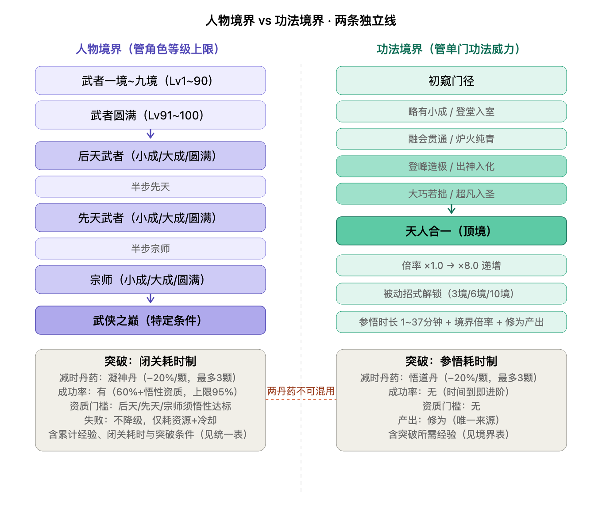

# 境界与突破系统

> **定位**：统一收纳本作**两条独立境界线**——「人物境界」与「功法境界」，以及各自的突破机制。
> **关联**：修为（武学突破产出）见 [`修为系统.md`](修为系统.md)；伤害公式见 [`08_balance/战斗数值.md`](../08_balance/战斗数值.md)；角色属性见 [`属性系统.md`](属性系统.md)。

---

## 一、两条境界线总览

| 维度 | 人物境界 | 功法境界 |
|------|----------|----------|
| **管什么** | 角色等级上限、属性台阶跃升 | 单门功法威力倍率、被动招式解锁 |
| **层级** | 武者九境 + 武者圆满 + 后天/先天/宗师/武侠之巅 | 初窥门径 → 天人合一（十境） |
| **突破方式** | **闭关耗时**（期间不可战斗/探索） | **参悟耗时**（后台计时，不中断行动） |
| **减时丹药** | **凝神丹**（每颗 −20%，单次最多 3 颗） | **悟道丹**（每颗 −20%，单次最多 3 颗） |
| **成功率** | 有：基础 60% + 悟性资质 + 道具，上限 95% | 无：时间到即进阶 |
| **资质门槛** | 进后天/先天/宗师须悟性达标 | 无 |
| **失败** | 不降级、不掉等级；耗资源 + 冷却 | 不会失败 |
| **产出** | 属性跃升 + 境界称号 | 威力倍率提升 + 被动解锁 + **修为产出** |

> ⚠️ **凝神丹与悟道丹是两种不同丹药，不可混用。** 两套境界独立，互不影响——但「功法境界突破」会产出修为（唯一来源）。

---

## 二、人物境界表

> **通用规则**（适用于所有境界突破）：
> - **触发**：达到当前境界经验上限（武者境为等级上限）时，需主动发起「突破」（闭关）。
> - **闭关耗时**：闭关期间不可战斗/探索（可提前出关，进度保留）。
> - **减时丹药**：服用「凝神丹」可减少闭关时长，每颗 −20%，单次最多 3 颗（累计至多 −60%）。
> - **成功率**：闭关完成时结算 `基础 60% + 悟性资质加成 + 道具加成`，上限 95%。
> - **失败**：不降级、不掉等级；冷却（打坐一个时辰）后可再次发起。
> - **成功**：属性台阶跃升 + 解锁下一段经验上限 + 获得境界称号。

| # | 境界 | 等级/阶段 | 累计经验（约） | 闭关耗时 | 突破条件 |
|---|------|----------|:----------:|:----------:|----------|
| 1 | 武者一境 | Lv 1~10 | 8,000 | 2 分钟 | 银两 |
| 2 | 武者二境 | Lv 11~20 | 30,000 | 4 分钟 | 银两（递增） |
| 3 | 武者三境 | Lv 21~30 | 80,000 | 6 分钟 | 银两（递增） |
| 4 | 武者四境 | Lv 31~40 | 170,000 | 8 分钟 | 银两（递增） |
| 5 | 武者五境 | Lv 41~50 | 300,000 | 12 分钟 | 银两（递增） |
| 6 | 武者六境 | Lv 51~60 | 480,000 | 16 分钟 | 银两（递增） |
| 7 | 武者七境 | Lv 61~70 | 720,000 | 20 分钟 | 银两（递增） |
| 8 | 武者八境 | Lv 71~80 | 1,000,000 | 24 分钟 | 银两（递增） |
| 9 | 武者九境 | Lv 81~90 | 1,350,000 | 30 分钟 | 银两（递增） |
| 10 | **武者圆满** | Lv 91~100 | 1,800,000 | 2 小时 | 银两 + 凝神丹 |
| 11 | **后天武者·小成** | 不显示等级 | 2,500,000 | 3 小时 | 银两 + 凝神丹 + 后天材料（药王谷炼丹线）+ **悟性≥门槛A** |
| 12 | **后天武者·大成** | 不显示等级 | 3,200,000 | 5 小时 | 后天段资源（递增）+ 凝神丹 |
| 13 | **后天武者·圆满** | 不显示等级 | 4,000,000 | 7 小时 | 后天段资源（递增）+ 凝神丹 |
| 14 | **半步先天** | 过渡 | 5,000,000 | 10 小时 | 先天突破资源（天地灵物，探索/奇遇线）+ **悟性≥门槛B** |
| 15 | **先天武者·小成** | 不显示等级 | 6,200,000 | 15 小时 | 先天段资源 + 凝神丹 |
| 16 | **先天武者·大成** | 不显示等级 | 7,500,000 | 20 小时 | 先天段资源（递增）+ 凝神丹 |
| 17 | **先天武者·圆满** | 不显示等级 | 9,000,000 | 30 小时 | 先天段资源（递增）+ 凝神丹 |
| 18 | **半步宗师** | 过渡 | 10,800,000 | 45 小时 | 宗师突破资源（武学至宝/宗师之证，**待设计**）+ **悟性≥门槛C** |
| 19 | **宗师·小成** | 不显示等级 | 12,800,000 | 60 小时 | 宗师段资源 + 凝神丹 |
| 20 | **宗师·大成** | 不显示等级 | 15,000,000 | 90 小时 | 宗师段资源（递增）+ 凝神丹 |
| 21 | **宗师·圆满** | 不显示等级 | 17,500,000 | 120 小时 | 宗师段资源（递增）+ 凝神丹 |
| 22 | **武侠之巅** | 最高 | — | — | 特定条件（机缘 + 资质 + 收集，**待设计**） |

> **累计经验**：武者境按角色经验曲线（`100 × 等级^1.3`）推算各境累计；后天以上为**设计初稿**（不显示等级，靠经验积累），需原型验证后收敛。
> **闭关耗时**：武者境用分钟、后天起用小时，随境界递增；全部为**设计初稿，需原型验证**（可按单局节奏整体缩放）。
> **突破条件**：每境突破所需资源与资质门槛；武者境=银两，→后天须悟性达标，→先天须更高悟性，→宗师须顶级悟性。具体门槛 A/B/C 数值**待定**。
> **武者圆满**是 Lv91~100 的收官段，也是迈向后天的门槛。

---

## 三、功法境界表

> **通用规则**（适用于所有功法境界突破）：
> - **触发**：功法经验到达当前境界上限时，经验暂停积累，需发起「参悟」方可进入下一境。
> - **参悟耗时**：按表中时长消耗；参悟为**后台计时**，不中断角色行动（可边赶路边参悟）。
> - **减时丹药**：服用「悟道丹」可减少参悟时间，每颗 −20%，单次最多 3 颗（累计至多 −60%）。
> - **确定性**：功法参悟**无成功率**——时间到即进阶（与人物境界突破的概率机制不同）。
> - **并行规则**：多门功法可同时参悟，时长独立计时；是否限同时 2 门，**待原型验证**。
> - **修为产出**：每次境界突破成功，产出对应武学类型的修为（详见 [`修为系统.md`](修为系统.md)）——这是修为的**唯一来源**。

| # | 境界 | 突破所需经验 | 参悟时长 | 境界倍率 | 修为产出（凡品基准） |
|---|------|:----------:|:----------:|:----------:|:----------:|
| 1 | 初窥门径 | 1,000 | 1 分钟 | ×1.0 | —（初始境） |
| 2 | 略有小成 | 3,000 | 2 分钟 | ×1.2 | +1 |
| 3 | 登堂入室 | 6,000 | 4 分钟 | ×1.5 | +1 |
| 4 | 融会贯通 | 10,000 | 7 分钟 | ×1.9 | +1 |
| 5 | 炉火纯青 | 15,000 | 11 分钟 | ×2.6 | +1 |
| 6 | 登峰造极 | 21,000 | 16 分钟 | ×3.3 | +1 |
| 7 | 出神入化 | 28,000 | 22 分钟 | ×4.3 | +2 |
| 8 | 大巧若拙 | 36,000 | 29 分钟 | ×5.4 | +3 |
| 9 | 超凡入圣 | 45,000 | 37 分钟 | ×6.6 | +4 |
| 10 | 天人合一 | — | —（顶境） | ×8.0 | +5 |

> **参悟时长规律**：1→2→4→7→11→16→22→29→37 分钟，差值递增 1（1,1,2,3,4,5,6,7,8）。
> **修为产出**：前五境各 +1，后四境递增（2/3/4/5），天人合一 +5；**每提升一个品级，每次突破额外 +2**（凡品 19 / 良品 37 / 上品 55 / 极品 73 / 绝世 91，单门练满）。
> **境界倍率**：按参悟时长规律（差值递增1）同步递增，天人合一收敛于 ×8.0。**数值为设计初稿，需原型验证。**

### 品质基础威力

| 品质 | 基础威力 |
|------|----------|
| 凡品 | 10 |
| 良品 | 20 |
| 上品 | 35 |
| 极品 | 55 |
| 绝世 | 80 |

> **两个独立维度**：品质（凡→绝世）是先天底子，境界（初窥→天人合一）是后天修炼深度。一门凡品练到天人合一可逼近未练深的绝世。

### 威力计算

**公式**：最终威力 = 品质基础威力 × 境界倍率；功法威力（入伤害公式）= 最终威力 × 3（见 战斗数值.md）。

| 功法 | 计算 | 最终威力 |
|------|------|----------|
| 凡品天人合一 | 10 × 8.0 | 80 |
| 上品登峰造极 | 35 × 3.3 | 115.5 |
| 上品天人合一 | 35 × 8.0 | 280 |
| 极品天人合一 | 55 × 8.0 | 440 |
| 绝世初窥门径 | 80 × 1.0 | 80 |
| 绝世天人合一 | 80 × 8.0 | 640 |

> **品质决定下限，境界决定上限**：凡品天人合一（80）等于绝世初窥门径（80），勤奋练功可弥补品质差距；但高品质功法天花板始终更高（绝世天人合一 640）。

---

## 四、招式结构

| 招式类型 | 数量 | 解锁方式 | 说明 |
|----------|------|----------|------|
| **主动招式** | 每门功法 **1 个** | 学会即拥有 | 消耗内力释放的核心技能，决定该功法的攻击方式与倍率 |
| **被动招式** | 每门功法 **n 个**（n 由品质决定） | 达到指定境界解锁 | 提供常驻加成/特殊效果（如吸血、连击、无视防御、触发类） |

### 品质与被动招式数量规则

> **核心规则**：被动招式数量由**品质**决定，品质越高被动越多。

| 品质 | 被动招式数 | 解锁境界节点 |
|------|:----------:|--------------|
| **凡品** | 1 个 | 登堂入室（第 3 境） |
| **良品** | 2 个 | 登堂入室（第 3 境）+ 登峰造极（第 6 境） |
| **上品** | 3 个 | 登堂入室（第 3 境）+ 登峰造极（第 6 境）+ 天人合一（第 10 境） |
| **极品** | 4 个 | 登堂入室（3）+ 融会贯通（4）+ 登峰造极（6）+ 天人合一（10） |
| **绝世** | 5 个 | 登堂入室（3）+ 融会贯通（4）+ 登峰造极（6）+ 出神入化（7）+ 天人合一（10） |

> **设计意图**：品质不仅是威力底子的差异，也是**被动深度**的差异——高品质功法不仅有更高天花板，还有更多被动效果可解锁，形成「品质越高，玩法越丰富」的长期追求动力。

### 示例：被动招式分布

| 功法 | 品质 | 被动数 | 被动1（境界） | 被动2（境界） | 被动3（境界） | 被动4（境界） | 被动5（境界） |
|------|------|:------:|---------------|---------------|---------------|---------------|---------------|
| 狂风刀法 | 凡品 | 1 | 狂风不息（登堂入室） | — | — | — | — |
| 断岳刀法 | 良品 | 2 | 断岳之势（登堂入室） | 断岳之力（登峰造极） | — | — | — |
| 断水刀法 | 上品 | 3 | 断水之势（登堂入室） | 水断不绝（登峰造极） | 断水无痕（天人合一） | — | — |
| 霸刀 | 极品 | 4 | 霸者之气（登堂入室） | 霸者之威（融会贯通） | 霸者横栏（登峰造极） | 霸者无双（天人合一） | — |
| 血刀大法 | 绝世 | 5 | 嗜血（登堂入室） | 血祭（融会贯通） | 血怒（登峰造极） | 血海（出神入化） | 血魔（天人合一） |

> 完整功法图鉴（含主动招式效果、伤害倍率、所有被动详细数值）见 [`功法系统.md`](功法系统.md) 第七节。

---

## 五、与其他系统的关系

| 系统 | 关系 |
|------|------|
| **修为系统** | 功法境界突破是修为的**唯一来源**；修为差距进入伤害公式（见 [`修为系统.md`](修为系统.md)） |
| **属性系统** | 人物境界管角色等级上限与属性台阶跃升；功法境界与之独立（见 [`属性系统.md`](属性系统.md)） |
| **战斗数值** | 功法威力 = 最终威力 × 3，进入伤害公式（见 [`08_balance/战斗数值.md`](../08_balance/战斗数值.md)） |
| **生活经营** | 炼丹线产出「悟道丹」「凝神丹」及后天突破材料（药王谷） |

---

> **本内容为设计草稿参考，正式落地前需经团队评审与合规审核。**
