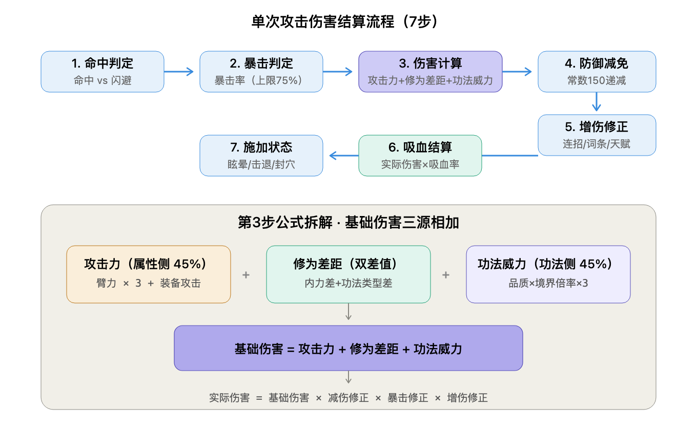

# 战斗数值与伤害结算

> 战斗伤害公式、属性换算、结算流程的完整数值模型。所有数值为初稿，需平衡调优。
> **整合说明（v0.9）**：本文件由原 `战斗数值.md` + `伤害计算.md` + `功法数值.md`（计算示例部分）合并而成。
> **关联**：角色属性见 [`05_combat/属性系统.md`](../05_combat/属性系统.md)；境界倍率与品质基础威力见 [`05_combat/境界系统.md`](../05_combat/境界系统.md) 第七节；修为见 [`05_combat/修为系统.md`](../05_combat/修为系统.md)。

---

## 一、战斗面板属性换算（L1 → L2）

| 一级属性 | 二级属性 | 换算公式 | 上限 |
|----------|----------|----------|------|
| 臂力 | 攻击力 | `臂力 × 3 + 装备攻击` | 无硬上限 |
| 臂力 | 暴击率 | `5% + 臂力/10% + 装备/词条` | 75% |
| 身法 | 命中 / 闪避 | `每 10 点身法 = +1% 命中 / +1% 闪避` | 命中 5%~95%；闪避 60% |
| 身法 | 出手速度 | `身法 + 轻功加成` | 决定出手顺序 |
| 根骨 | 防御力 | `根骨 × 1.5 + 装备防御` | 减伤边际递减（常数 150） |
| 根骨 | 气血 | `根骨 × 20 + 装备气血 + 内功气血` | 无硬上限 |
| 内息 | 内力 | `内息 × 10 + 内功内力` | 无硬上限 |
| 内息 | 内力回复 | `内息/10 + 内功加成`（每回合） | — |
| — | 暴击伤害 | `150%（基础）+ 装备/词条` | 300% |
| — | 吸血 | `内功被动 / 词条 / 三连连招 / 天赋` | 不超过气血上限 |
| — | 增伤修正 | `1 + 连招 + 词条 + 天赋 + 境界` | 各来源相加 |

> 原「怒气」派生属性及大招机制**已移除**。若需恢复「大招」体验，需另行指定其积攒资源（如内力/冷却）后单独设计。

---

## 二、核心伤害公式

| 量 | 公式 |
|----|------|
| **攻击力** | 臂力 × 3 + 装备攻击 |
| **功法威力** | 品质基础威力 × 功法境界倍率 × 3（品质威力与倍率见 境界系统.md 第七节） |
| **修为差距** | 内力修为差距 + 功法类型修为差距（负数 ÷ 2，见 修为系统.md 第四节） |
| **基础伤害** | 攻击力 + 修为差距 + 功法威力 |
| **实际伤害** | 基础伤害 × 减伤修正 × 暴击修正 × 增伤修正 |

### 各因子定义

| 因子 | 公式 | 说明 |
|------|------|------|
| 攻击力 | `臂力 × 3 + 装备攻击` | 属性侧底盘（权重 45%） |
| 功法威力 | `品质基础威力 × 功法境界倍率 × 3` | 功法侧上限（权重 45%）；品质威力与境界倍率见 [`境界系统.md`](../05_combat/境界系统.md) 第七节 |
| 修为差距 | `内力修为差距 + 功法类型修为差距`；**合计为负时 ÷ 2** | 内力修为差距 = 我方内力修为 − 敌方内力修为；功法类型修为差距 = 我方当前攻击功法类型修为 − 敌方同类型修为；1 点 = 1 点伤害；跨类型不结算；详见 [`修为系统.md`](../05_combat/修为系统.md) 第四节 |
| 基础伤害 | `攻击力 + 修为差距 + 功法威力` | 三源相加 |
| 减伤修正 | `1 - 防御力 / (防御力 + 150)` | 防御常数 150，边际递减 |
| 暴击修正 | 触发暴击 × 1.5，否则 × 1.0 | 暴击伤害上限 300% |
| 增伤修正 | `1 + 连招加成 + 词条加成 + 天赋加成 + 境界加成` | 各来源相加 |

### 计算示例（Lv50 参考面板）

假设：臂力 80 → 攻击力 = 80 × 3 + 装备 100 = **340**；修为差距 = 内力修为差距(+40) + 刀法修为差距(+10) = **+50**；目标防御 90 → 减伤 = 1 − 90/240 = **0.625**。

| 功法 | 功法威力（×3 后） | 基础伤害 = 340 + 50 + 功法 | 实际伤害（×0.625） |
|------|------------------|-----------------------------|--------------------|
| 凡品初窥门径 | 30 | 420 | ≈ 263 |
| 凡品天人合一 | 240 | 630 | ≈ 394 |
| 上品登峰造极 | 346.5 | 736.5 | ≈ 460 |
| 极品天人合一 | 1320 | 1710 | ≈ 1069 |
| 绝世天人合一 | 1920 | 2310 | ≈ 1444 |

> **权重观察**：在「上品登峰造极」这一常见节点，属性侧（臂力 240）: 功法侧（346.5）≈ **41 : 59**，功法侧略高——符合「功法决定上限」的设计意图；修为差距（50）作为第三条独立来源，放大同类型武学的深度差异。

### 功法威力计算示例（品质 × 境界）

> 「最终威力 = 品质基础威力 × 境界倍率」，进入伤害公式时再 ×3。

| 功法 | 计算 | 最终威力 | ×3 后（入公式） |
|------|------|----------|-----------------|
| 凡品天人合一 | 10 × 8.0 | 80 | 240 |
| 上品登峰造极 | 35 × 3.3 | 115.5 | 346.5 |
| 上品天人合一 | 35 × 8.0 | 280 | 840 |
| 极品天人合一 | 55 × 8.0 | 440 | 1320 |
| 绝世初窥门径 | 80 × 1.0 | 80 | 240 |
| 绝世天人合一 | 80 × 8.0 | 640 | 1920 |

> **要点**：品质决定下限，境界决定上限——凡品天人合一（80）等于绝世初窥门径（80），勤奋练功可弥补品质差距；但高品质功法天花板始终更高（绝世天人合一 640）。

---

## 三、单次攻击结算流程

**单次攻击**：出手 → 目标确定 → 命中判定 → 暴击判定 → 伤害计算 → 减伤 → 增伤 → 群体递减 → 吸血 → 施加状态。

**回合末尾**：持续伤害结算 → 组合效果检测 → 状态回合数 −1 → 到期清除。

| 步骤 | 判定内容 | 说明 |
|------|----------|------|
| 0. 目标确定 | 招式范围 → 候选池 → 战斗倾向排序 | 按范围（10 型）生成候选池，再按「优先输出 / 优先连招」排序取前 C 个；多目标时逐个走后续步骤 |
| 1. 命中判定 | 命中 vs 闪避 | 未命中则本次攻击落空，结束结算 |
| 2. 暴击判定 | 暴击率 | 触发则伤害 × 暴击倍率 |
| 3. 伤害计算 | 攻击力 + 修为差距 + 功法威力 | 基础伤害（双轨并重 + 修为压制） |
| 4. 防御减免 | 防御力减伤 | 防御越高减伤越多，但不为负 |
| 5. 增伤修正 | 连招/词条/天赋/境界 | 各种加成按序相乘或相加 |
| 5.5 群体递减 | `a_i = max(0.4, 1−0.15×(i−1))` | 多目标时**乘在最终伤害上**，按序位递减；单体不受影响 |
| 6. 吸血结算 | 吸血率 | 最终伤害 × 吸血率 转为气血 |
| 7. 施加状态 | 状态有效值 × 生效率 | 控制类掷骰、减益类打折数值，并检测组合效果（见第十一节） |
| 8. 回合末尾 | 持续伤害 / 组合 / 回合数 −1 / 到期清除 | 每回合结束时统一执行一次 |

> **结算顺序固定**：目标确定 → 命中 → 暴击 → 基础伤害 → 减伤 → 增伤 → 群体递减 → 吸血，保证可预测。

**补充：多目标（范围）结算**

- 招式命中数 > 1 时，`⓪` 先按范围选出**有序**目标列表（第 1 位为主目标），再对每个目标**依次**执行 ①~⑦；`⑤.5 群体递减` 对第 `i` 个目标取系数 `a_i`。
- **递减只作用于伤害**：治疗 / 增益 / 阵法 / 内功 buff 不递减。
- **3 目标示例**（`范围大招 ×0.7` 打 n=3）：

| 序位 | 系数 a_i | 相对单目标伤害 |
|:----:|:--------:|:--------------:|
| 1（主目标） | 1.00 | 100% |
| 2 | 0.85 | 85% |
| 3 | 0.70 | 70% |
| **合计 S(3)** | **2.55** | 等效 2.55 个单体 |

> **倍率 × 范围对应总表（含三条禁配红线）**见 [`05_combat/功法系统.md`](../05_combat/功法系统.md) §6.4；10 型定义、十字 / 随机 N、选目标见同文 §6.5；递减系数见 [`GDD/03`](../GDD/03_数值框架.md) §3.1.4a。

---

## 四、防御减伤曲线

**减伤率 = 防御力 ÷（防御力 + 150）**

| 防御力 | 减伤率 |
|--------|--------|
| 0 | 0% |
| 50 | 25% |
| 100 | 40% |
| 150 | 50% |
| 300 | 66.7% |
| 600 | 80% |

> 防御常数 150，减伤边际递减：从 0→150 收益最大，之后递减。高防御适合「坦克」前排，但无法无限堆到接近 100%。

---

## 五、命中与闪避

| 项 | 基准 | 上下限 |
|----|------|--------|
| 命中率 | 90% + 命中加成 − 目标闪避 | **5% ~ 95%** |
| 闪避率 | 身法/10% + 装备/词条 | 最高 **60%** |

- 命中与闪避独立判定，永远有 miss / 命中的可能。
- 身法是闪避与命中的主要来源，身法流通过堆闪避实现「miss 流」。

### 招架对抗（属性配对）

- 招式被招架后，**我方臂力 vs 敌方根骨**的差值决定仍造成的伤害比例（差值越大，被招架损失越小）。
- 属于「对抗配对」机制（详见 [`属性系统.md`](../05_combat/属性系统.md) 第六节），系数待原型验证。

---

## 六、暴击

| 项 | 基准 | 上限 |
|----|------|------|
| 暴击率 | 5%（+臂力/10%） | 75% |
| 暴击伤害 | 150% | 300% |

- 暴击与闪避独立判定，先命中后暴击。

---

## 七、连招加成

- 连招成功：套路威力 **+30%**
- 三连成功：套路威力 **+60%**，触发吸血
- 连招加成在「增伤修正」阶段结算，与词条加成叠加。
- 详见连招系统。

---

## 八、词条与被动加成

- 三层词条搭配（套路间 / 内功套路 / 内功身法）提供百分比加成
- 功法被动招式（达到对应境界解锁，如「狂风不息」「霸者横栏」）提供额外效果——被动招式表见 [`境界系统.md`](../05_combat/境界系统.md) 第六节
- 天赋加成（如「百兵之王」威力 +25%）同样在增伤修正阶段生效

---

## 九、吸血结算

- 吸血按「最终实际伤害」计算
- 来源：三连连招触发、内功被动、词条、天赋（独行天下）
- 吸血不产生溢出治疗（气血上限封顶）

---

## 十、内力消耗与回复

| 项 | 基准 |
|----|------|
| 套路内力消耗 | 按功法品质：凡品 10 / 良品 20 / 上品 35 / 极品 55 / 绝世 80（每次释放） |
| 内力回复 | `内息/10 + 内功加成`（每回合） |
| 内力耗尽 | 自动改用普攻（普攻 = 攻击力 × 0.5，无消耗） |
| 冷却 | **无冷却**——内力够就能放，不够就放不了 |

---

## 十一、状态结算

> 16 种状态的完整定义、有效值表与组合效果见 [`05_combat/状态效果系统.md`](../05_combat/状态效果系统.md)。

### 11.1 生效率（唯一抵抗阀）

| 量 | 公式 |
|----|------|
| **韧性** | 根骨 × 0.5 + 内功韧性 + 装备韧性 + 境界加成 |
| **生效率** | 状态有效值 ÷（状态有效值 + 韧性），**下限 25%** |
| **状态有效值** | 基础有效值 × 来源系数（凡 1.0 / 良 1.1 / 上 1.25 / 极 1.5 / 绝 1.75） |

| 状态类型 | 生效率的用法 |
|----------|--------------|
| **控制类**（眩晕 / 封穴 / 定身 / 击退） | **掷骰**：生效率 = 命中率，结果只有中 / 不中 |
| **减益 / 持续伤害类** | **打折数值**：`实际效果 = 面板效果 × 生效率` |
| **增益类** | 不受影响 |

> **阶梯原则**：状态越强 → **基础概率越低 + 基础有效值越低**（双低）。眩晕：基础概率 20%、有效值 75（全场最低），最终命中率约 10.8%；击退：45% / 130，约 30.2%——**强控制必然难中**，韧性是对抗强控制的正解。

**控制递减**：同一目标在同一场战斗中，第 2 次受控生效率 ×0.6，第 3 次及以后 ×0.35（仅控制类）。

### 11.2 回合末尾结算

| 顺序 | 内容 |
|:----:|------|
| ① | 按出手顺序逐个单位结算**持续伤害**（中毒 / 灼烧按最大气血，流血按当前气血） |
| ② | 检测并触发**组合效果**（6 组，同目标同时存在指定两状态时自动触发） |
| ③ | 所有状态**剩余回合 −1** |
| ④ | **清除到期状态** |

> 持续伤害放在回合末而非回合开始结算，避免"刚被施加就立刻吃一次伤害"的体感问题。

### 11.3 叠加规则

| 类型 | 规则 |
|------|------|
| 控制 | 眩晕 / 封穴 / 定身**互斥取最新**；击退独立 |
| 减益 | **层数 +1**（不超上限），剩余回合取较大值 |
| 增益 | **不叠层**，取最大值并刷新回合 |

---

## 设计要点

- **双轨并重（属性 45% / 功法 45% / 装备·词条·天赋 10%）**：攻击力（臂力 ×3）与功法威力（品质 × 境界 ×3）相加，两条成长线都有效且可叠加。
- **系数调整说明**：早期「属性 ×2、功法威力 ×5」使功法占约 70%+；调整为 **属性 ×3、功法威力 ×3** 后达成双轨并重。
- **移除招式属性绑定**：功法不再绑定主属性，伤害属性侧统一为 **攻击力（臂力 ×3）**，功法选择更自由；流派区分改由**词条 / 功法特性**承载。
- **移除怒气**：L2 派生属性不再含怒气，原大招机制一并移除。
- **修为差距入伤害（双差值制）**：修为差距 = 内力修为差距 + 功法类型修为差距；**合计为负时 ÷ 2**（劣势惩罚减半）；详见 [`修为系统.md`](../05_combat/修为系统.md) 第四节。
- **防御常数 150 边际递减**：防止坦克流派失衡。
- **暴击/闪避设上下限**：避免极端值破坏对抗。
- **普攻兜底**：内力耗尽也能继续作战，不卡死。
- **状态抵抗用单一韧性阀**：`生效率 = 有效值/(有效值+韧性)`，一套公式两种解释（控制掷骰、减益打折），配合控制递减防止被锁死；详见 [`05_combat/状态效果系统.md`](../05_combat/状态效果系统.md)。

---

> **本内容为设计草稿参考，正式落地前需经团队评审与合规审核。**
