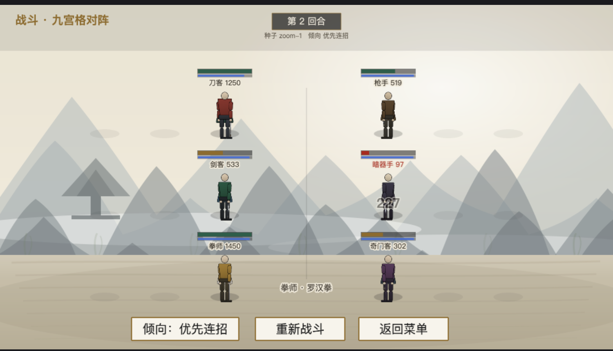
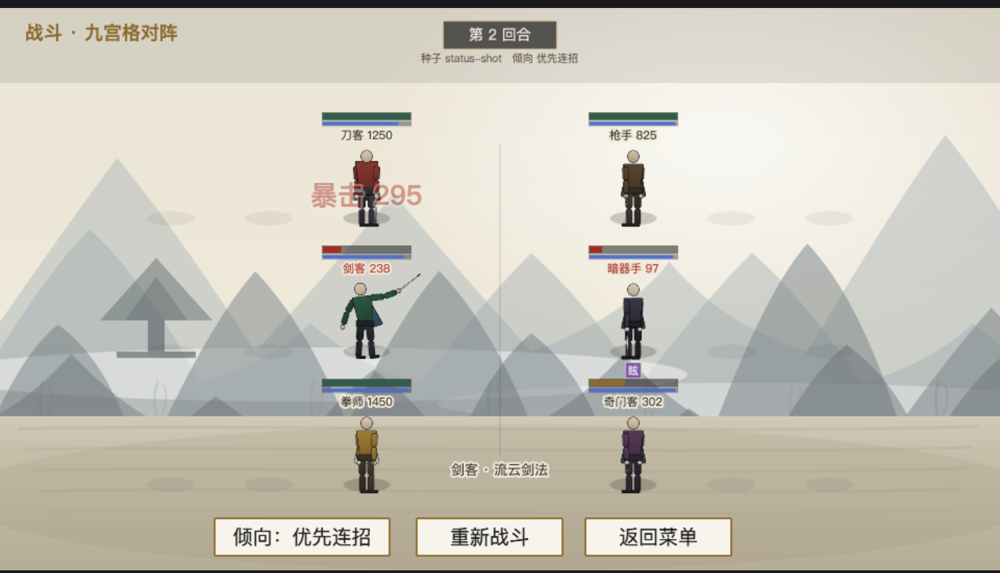

# 美术资源管线（assets pipeline）

> 版本：v1.0｜适用：方案 C（自研轻量 cutout 骨骼）
> 一句话：**把 PNG 丢进 `assets/` 的对应目录，跑 `pnpm skin:gen`，就生效 —— 代码零改动。**

---

## 0. 先看效果

下图是 `pnpm art:placeholder` 生成的**占位贴图**跑在真实战斗里的样子（无头 Chrome 实拍，非合成图）：
三层水墨背景 + 6 个角色各自换色 + 按品质换过的武器 + 头顶状态图标。

| 画面元素 | 数据来源 |
|----------|----------|
| 6 个角色的外观 | `assets/chars/<charId>/parts/`（3 套底图）+ `skin.json` 的 `palette` 换色 |
| 手里的武器 | `units.csv` 的 `group` × 当前功法品质 → `assets/weapons/<组>/<组>_<后缀>.png` |
| 三层背景 | `assets/bg/battle/{far,mid,ground}.png` |
| 头顶 **状态图标**（下图为「眩」= 眩晕） | 战斗日志的 `statusApplied` / `statusExpired` 事件 |

> 第二张截图为了让状态必定出现，**临时**把罗汉拳的眩晕概率从 15% 调到 100% 再还原；
> 仓库里的配置是设计值 15%（`data/tables/skills.csv`）。

---

## 1. 三条命令

| 命令 | 作用 | 什么时候用 |
|------|------|-----------|
| `pnpm art:placeholder` | 生成**合规的占位贴图**（尺寸/枢轴/命名全对），**默认不覆盖已有文件** | 想先看管线效果 / 新角色起手模板 |
| `pnpm skin:gen` | 扫描 `assets/` → 校验 → 生成 `skin.json` | **每次改完贴图都要跑** |
| `pnpm skin:check` | 只校验不写盘 | CI / 提交前自检 |

标准的改图循环：

| 步骤 | 操作 |
|:--:|------|
| 1 | 用你画的 PNG **同名覆盖** `assets/chars/<角色>/parts/<slot>.png` |
| 2 | 跑 `pnpm skin:gen` |
| 3 | 浏览器刷新（Vite 热更新，不用重启 dev server） |

> ⚠️ `skin.json` 里的 `parts` 段由工具生成，**手改会在下次导入被覆盖**；
> 但 `name / body / art / palette / weaponGroup` 是**给人写的**，工具会原样保留。

---

## 2. 换角色贴图

### 2.1 目录与命名（**文件名就是登记**，不需要在代码里登记资源）

| 路径 | 内容 |
|------|------|
| `assets/chars/<charId>/parts/<slot>.png` | 17 个部件，**文件名严格等于 slot 名** |
| `assets/chars/<charId>/skin.json` | 由 `pnpm skin:gen` 生成 + 维护 |
| `assets/weapons/<组>/<组>_<品质>.png` | 武器贴图，**全角色共享** |
| `assets/bg/battle/{far,mid,ground}.png` | 战斗背景三层 |

`<charId>` 与 `data/tables/units.csv` 的 **`charId` 列**对应 —— 换皮只改这一列。

### 2.2 17 个 slot 与画布尺寸

严格按 [`rig-spec.md`](rig-spec.md) §2 / §4。要点：

| 规则 | 说明 |
|------|------|
| 画布 = 骨架绘制盒 **× 2** | 例：`torso` 40×46 → 画布 **80×92** |
| 枢轴 = **关节旋转中心** | 写进 `skin.json`；画错在导入期就报错 |
| 部件之间重叠 8~12 px | 旋转时不露缝 |
| 统一**面向右** 3/4 视角 | 朝左由程序镜像，省一半贴图 |
| 透明背景 PNG，不裁边 | 保证枢轴一致 |
| `cloak` / `weapon` | 可选（拳掌类无武器、不是每个角色都要飘带） |

> 唯一权威是代码：跑 `pnpm skin:check`，尺寸/枢轴不对它会**直接告诉你应该是多少**。

### 2.3 `skin.json` 字段

| 字段 | 谁维护 | 说明 |
|------|:------:|------|
| `id` | 工具 | = 目录名 |
| `name` | **人** | 显示名（战报/调试用） |
| `body` | **人** | 体型 id：`male_adult` / `female_adult` / `burly`（见 rig-spec §3） |
| `art` | **人** | 复用另一套贴图（填对方 charId），见 §3 |
| `palette` | **人** | 逐 slot 换色（见 §3） |
| `weaponGroup` | **人** | `dao`/`jian`/`qiang`/`anqi`/`qimen`；有值才按品质换武器 |
| `parts` | 工具 | 每个 slot 的文件路径 + 画布尺寸 + 枢轴 |

### 2.4 三件最常见的错，长这样

| 错误 | 报错（导入期） |
|------|----------------|
| 少画一个部件 | `✗ [MISSING_PART] 缺少必需部件「torso」——文件名必须严格等于 slot 名` |
| 画布尺寸不对 | `✗ [BAD_SIZE] 「torso」画布应为 80×92（male_adult @2×），实际 90×103` |
| 枢轴不在关节 | `✗ [BAD_PIVOT] 「footR」枢轴应为 0.25,0.5（关节旋转中心），实际 0.5,0.5` |

**有 error 就不会写盘**（脏数据进不来），所以不会出现"半套新图 + 半套旧图"的诡异画面。

---

## 3. 复用一套图做多个角色（`palette`）

这是成本复利的关键：**贴图按体型准备 3 套，角色之间靠换色区分**（rig-spec §8）。

| 做法 | 成本 |
|------|------|
| 每个角色画 17 张 | 1~2 人日 / 角色 |
| 复用底图 + 写 6 个颜色 | **~10 分钟 / 角色** |

示例：`ren_dao`（刀客）不画任何图，只声明

| 字段 | 值 |
|------|-----|
| `art` | `base_burly` |
| `body` | `burly` |
| `palette` | 6 个颜色 → 铺满 16 个 slot（袍主色/袍暗面/裤/裤暗面/肤色/鞋色 + 披风） |

> ⚠️ **贴图不能跨体型复用**：`female_adult` 的躯干画布是 77×88，`male_adult` 是 80×92，
> 少几个像素就会被校验器拦下。正确做法是每个体型一套底图（`base_male` / `base_female` / `base_burly`）。
>
> ⚠️ `palette` 是**乘法着色**：贴图画成中性灰时换色最准；全彩贴图上叠色会偏暗。
> 这也是占位贴图刻意画成中性色（`#f2efe8 → #c3bdb2` 渐变）的原因 —— 换色一步到位。

---

## 4. 武器贴图（按「类型 × 品质」共享，25 张覆盖全游戏）

| 项 | 说明 |
|----|------|
| 路径 | `assets/weapons/<组>/<组>_<后缀>.png` |
| 组 | `dao` / `jian` / `qiang` / `anqi` / `qimen`（拳掌/内功/身法不画武器） |
| 品质后缀 | 凡 `fan` ／ 良 `li` ／ 上 `bao` ／ 极 `shen` ／ 绝 `chuan` |
| 尺寸 | 14×112（@2×，全角色共用；武器绘制盒不随体型缩放） |

**为什么共享？** 玩家认知自然（"这是一把宝器剑"），且是**外观付费的切入点**；
角色专属武器只在"传世品质 + 剧情关键"时才单独画。

单位装备什么武器由 `units.csv` 的 `group` 决定，外观档次由**当前主要功法的品质**决定
（`SkillConfig.quality`）—— 也就是"练的功法越好，手里那把看着越贵"。

---

## 5. 战斗背景

| 层 | 文件 | 作用 |
|:--:|------|------|
| 远 | `assets/bg/battle/far.png` | 天空渐变 + 远山 + 雾带（最淡） |
| 中 | `assets/bg/battle/mid.png` | 近山 + 建筑剪影 + 竹林（中调） |
| 地 | `assets/bg/battle/ground.png` | 地面平面 + 墨色笔触 + 暗角 |

| 项 | 约定 |
|----|------|
| 尺寸 | **960×540（1×）**；想出高清就画 1920×1080，代码无需改（FIT 缩放） |
| 格式 | PNG（带透明通道最好，三层可叠出纵深） |
| 缺图行为 | **自动跳过该层**，退回宣纸底色 —— 不会黑屏，美术可分批交付 |
| 替换 | 同名覆盖即可，无需改代码（Vite 构建期扫描目录） |
| 九宫格线 | 已**取消**方框，改为每个站位的软投影 + 一条极淡中线；想恢复见 §6 |

---

## 6. 战斗 UI：想改什么改哪里

全部集中在 [`src/render/scenes/BattleScene.ts`](../src/render/scenes/BattleScene.ts) 顶部的一组常量：

| 想改 | 改哪个常量 / 位置 | 备注 |
|------|------------------|------|
| 角色大小 | `CHAR_SCALE` | 0.52 |
| 三行站位的行距 | `ROW_GAP` | **与信息栈高度联动**，见文件内注释 |
| 状态图标 / 血条 / 内力条 / 姓名行的上下位置 | `STATUS_Y` / `HP_BAR_Y` / `INNER_BAR_Y` / `INFO_Y` | 负值 = 头顶方向 |
| 脚下投影 | `SHADOW_Y` | |
| 血条宽度与颜色 | `HP_BAR_W` / `HP_BAR_H`、`refreshHp()` | 低血变金/变红 |
| 内力条颜色 | `INNER_COLOR` / `INNER_COLOR_LOW` | 见底变灰 = 下一手只能普攻 |
| 状态图标颜色（按类别） | `STATUS_COLOR` | 控制=紫 / 减益=红 / 增益=青碧（对齐《状态效果系统.md》） |
| 状态图标数量上限 | `renderStatusIcons()` 的 `slice(0, 4)` | 超出折叠成「+N」 |
| 飘字位置与描边 | `floatText()` 调用处 + 函数体 | 用浅色描边保证压在背景上可读 |
| HUD 横幅高度 | `drawHud()` 里的 `72` | 第一行信息栈从 y=76 开始，改小会撞 |
| 阵法提示位置 | `drawHud()` 的 `allyFormationText` / `enemyFormationText` | |
| 站位投影（场地标记） | `drawFieldMarks()` | 想恢复九宫格方框就在这里画 |

> **布局是"一起调"的**：一行的垂直占用 ≈ 状态图标 15 + 血条 6 + 内力条 3 + 姓名行 12 + 角色 73 ≈ 124px，
> 所以 `ROW_GAP` 必须 > 124。早期版本把姓名牌放在脚下、血条放在头顶，结果姓名牌与下一行血条**重叠 2px** ——
> 这是调这几个常量时最容易踩的坑。

---

## 7. 出错会在哪一层被拦住（不会静默出错）

| 错误 | 拦住它的地方 |
|------|------------|
| `parts/` 里少一个部件 | `pnpm skin:gen`（导入期） |
| 画布尺寸 / 枢轴不对 | `pnpm skin:gen` + `pnpm skin:check` |
| 文件名拼错（不是已注册 slot） | `pnpm skin:gen`（warn，不会静默忽略） |
| 引用了不存在的体型 | `pnpm skin:gen` |
| `units.csv` 的 charId 没有对应贴图 | 测试 `tests/skin.test.ts` + 启动期校验页 |
| 皮肤与体型不匹配（跨体型复用） | 测试 + 启动期校验页 |
| 武器组缺某个品质的图 | `pnpm skin:gen`（warn） |
| 贴图加载失败 | 启动页会**红字列出文件名**（不白屏） |

CI 三条命令：`pnpm typecheck` + `pnpm skin:check` + `node --test "tests/**/*.test.ts"`。

---

## 8. 性能与后续

| 项 | 现状 | 后续 |
|----|------|------|
| 加载 | 79 张贴图 + 9 份 skin.json，`assets/` 共 ~440KB；Vite 构建期静态分析，无运行时清单 | 贴图多了以后打图集（`pnpm atlas:pack` **尚未实现**），注意移动端 2048 上限 |
| 绘制 | 每角色 17 个显示对象，**预创建 + 每帧只改属性** | 同屏 10 人 = 170 对象，仍在安全区 |
| 高清 | 管线按「画布 = 逻辑 × `ART_SCALE`」设计 | 想上 2× 只需改 `ART_SCALE` 并重画（占位生成器会跟着变） |
| 换色 | `palette` 逐 slot tint（合批开销小） | 若 tint 不够用，可改为"每个角色一套图" |

---

## 9. 相关文件

| 文件 | 作用 |
|------|------|
| `src/core/anim/skin.ts` | **皮肤契约**（期望尺寸/枢轴由骨架推导、校验规则、武器路径） |
| `src/render/anim/SkinRegistry.ts` | 皮肤注册表（资源路径 ↔ 纹理 key ↔ 单位 charId） |
| `src/render/anim/RigView.ts` | 部件渲染：**有图用 Image，没图回退色块** |
| `src/render/anim/CharacterView.ts` | 角色视图（骨架 + 动作 + 朝向 + 皮肤） |
| `src/render/scenes/PreloadScene.ts` | `import.meta.glob` 扫全量资源 → 加载 → 启动期校验 |
| `src/render/scenes/BattleScene.ts` | 战斗演出与 UI（§6 的常量都在这里） |
| `tools/gen-skin.ts` | 皮肤导入器（校验 + 生成 skin.json，**零依赖**，自己读 PNG 文件头） |
| `tools/gen-placeholder-art.ts` | 占位美术生成器（sharp 渲染 SVG → PNG） |
| `docs/rig-spec.md` | 骨架与部件规范（**画图前必读**） |
| `tests/skin.test.ts` | 16 项守护测试（含"真实资源全部合规""配置表 ↔ 资源目录闭合"） |
