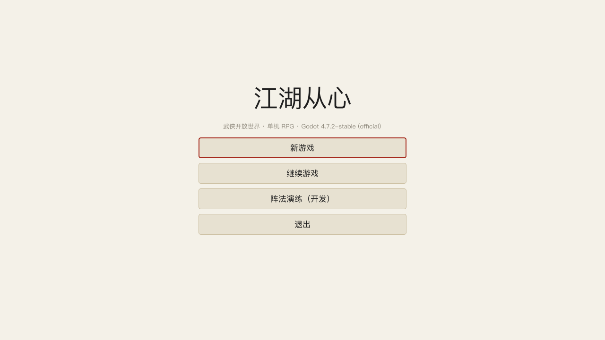
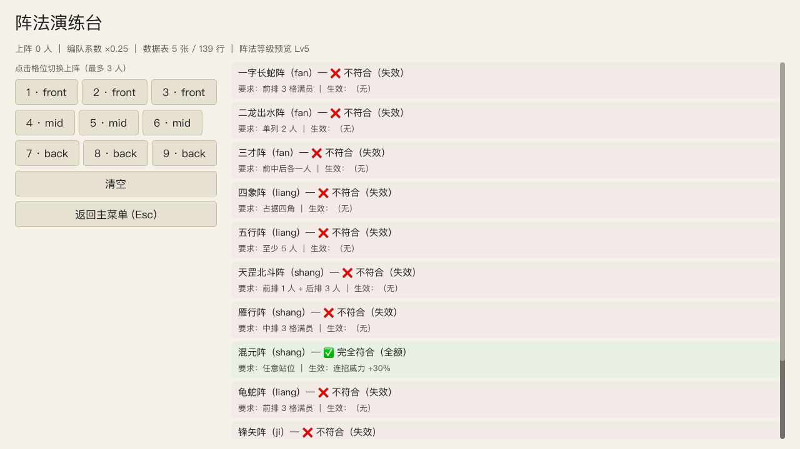

# 江湖从心 · Godot 工程

> 武侠开放世界 + 单机 RPG ｜ 引擎：**Godot 4.7.x** ｜ 目标：移动端（iOS/Android）+ PC

---

## 快速开始

```bash
# 1) 用编辑器打开（首次会自动导入资源）
open -a /Users/zq/Downloads/Godot.app --args --path "$(pwd)"

# 2) 跑单元测试（无头、零依赖，退出码 = 失败用例数）→ 57 项
/Users/zq/Downloads/Godot.app/Contents/MacOS/Godot --headless --path "$(pwd)" --script res://tests/run_tests.gd

# 2b) 跑集成测试（数据表 + 存档往返 + 存档迁移）→ 33 项
#     注意：必须用 --scene 方式启动，--script 模式下 autoload 全局名编译期不可解析
/Users/zq/Downloads/Godot.app/Contents/MacOS/Godot --headless --path "$(pwd)" \
  --scene res://tests/integration/integration_runner.tscn \
  -- --saves-dir="$(pwd)/build/itest"

# 3) 渲染真实画面到 PNG（视觉验证；**不要加 --headless**）
GODOT_BIN=/Users/zq/Downloads/Godot.app/Contents/MacOS/Godot \
  ./tools/ci/render_frames.sh "res://scenes/main_menu/main_menu.tscn" 12 build/frames 1280x720
```

> 💡 Godot 可执行文件在 `~/Downloads/Godot.app/Contents/MacOS/Godot`。

### 直接运行游戏

```bash
/Users/zq/Downloads/Godot.app/Contents/MacOS/Godot --path "$(pwd)" --resolution 1280x720
```

**存档目录**（四级兜底，任何环境都能存）：

| 优先级 | 来源 | 用途 |
|:------:|------|------|
| 1 | 启动参数 `-- --saves-dir=<绝对路径>` | CI / 沙箱 / 便携版 |
| 2 | 环境变量 `JH_SAVE_DIR` | 自定义部署 |
| 3 | `user://saves` | **发行版标准位置** |
| 4 | `res://.local_saves` | 开发期兜底（导出后只读会自动跳过） |

---

## 当前状态

| 里程碑 | 状态 | 说明 |
|--------|:----:|------|
| **工程骨架 + 目录规范** | ✅ 完成 | 62 个目录、分层架构、命名规范成文 |
| **可运行场景链** | ✅ 完成 | 启动 → 主菜单 → 世界 / 战斗 / 阵法演练台 |
| **数据管线** | ✅ 完成 | 5 张表 / 139 行 JSON，启动即校验，失败不静默 |
| **核心逻辑测试** | ✅ **57 项**全绿 | 九宫格 / 阵法 / 数据表 / 编队系数 |
| **集成测试** | ✅ **33 项**全绿 | 数据注册表 / 存档往返 / v0→v1 迁移 |
| **视觉验证能力** | ✅ 打通 | `--write-movie` 渲染 PNG，AI 可自动看图 |
| 战斗预结算内核 | ⏳ 下一步 | 伤害公式 → 事件流 → 表现回放 |
| 骨架动画（cutout） | ⏳ 待做 | slot 规范见 `../jianghu-game/docs/rig-spec.md` |
| 多端导出 | ⏳ 待做 | Android / iOS / Windows / macOS 导出预设 |

### 预览

| 启动画面 | 主菜单 | 阵法演练台 |
|:--------:|:------:|:----------:|
|  |  |  |

---

## 目录结构（详见 `docs/PROJECT_STRUCTURE.md`）

```
jianghu-godot/
├─ docs/          文档（工程规范、架构、预览图）
├─ addons/        插件（Godot 保留名）
├─ assets/        原始资产（美术 / 音频 / 字体 / 全局主题）
├─ data/          设计数据源（策划编辑的 CSV）+ schema
├─ src/
│  ├─ autoload/   全局单例：EventBus / GameState / DataRegistry / SaveManager / SceneRouter
│  ├─ core/       纯逻辑（禁依赖场景树）：battle / formula / progression / economy / quest / sect / save / anim / rng
│  ├─ data/       数据层：tables（生成的 JSON）/ registry / schema
│  ├─ presentation/ 表现层：ui / battle / anim / audio / widgets
│  └─ platform/   平台适配（Steam / 触屏 / 安全区）
├─ scenes/        boot / main_menu / world / battle / ui / dev
├─ resources/     自定义 Resource 实例（gongfa / equipment / formations / status / motions）
├─ tests/         测试（run_tests.gd + unit + integration）
├─ tools/         导入器、CI 脚本
└─ build/         导出产物（git 忽略）
```

---

## 三条架构铁律

| # | 铁律 | 落地方式 |
|:-:|------|----------|
| 1 | **逻辑与表现分离** | `core/` 不得 `extends Node`、不得 `get_tree()`、不得 `preload` 场景；战斗「先算完再回放」 |
| 2 | **内容与代码分离** | 一切内容走 `src/data/tables/*.json`；代码内不得出现功法名/数值常量 |
| 3 | **数据引擎中立** | 配置表是纯 JSON，TS 与 GDScript 共读；换引擎的代价只落在代码 |

依赖方向只允许：`presentation → core → data`（`platform` / `autoload` 横向支撑）。

---

## 数据流

```
data/source/*.csv          策划编辑的源表
        │
        ▼  tools/import（待实现）
src/data/tables/*.json     运行期唯一真相 ← 当前由 jianghu-game/tools/export-tables.ts 从 TS 导出
        │
        ▼  DataRegistry（启动校验：必需表 / 主键唯一 / JSON 合法）
core/*                     纯逻辑读取
        │
        ▼  EventBus（事件）
presentation/*             表现层回放
```

> 当前 `src/data/tables/` 由 TypeScript 侧导出（`../jianghu-game/tools/export-tables.ts`），
> 这样做的好处：**同一份数据同时被 Phaser 原型与 Godot 工程读取**，
> 在确定最终引擎前，内容资产不会因选型而重做。

---

## 关键约定（新人/AI 必读）

1. **不要直接调用 `get_tree().change_scene_to_file()`** —— 走 `SceneRouter.goto()`（带转场、可拦截、有历史栈）。
2. **不要在 `core/` 里 import 场景或节点** —— 见铁律 1。
3. **新增配置表字段** 必须同步更新 `data/schema/`。
4. **中文字体**：Godot 内置字体不含 CJK，已通过 `assets/fonts/ui_theme.tres` 的 `SystemFont` 解决；
   控件字色必须显式指定，否则「浅底浅字」不可读。
5. **`--headless` 不出图**：headless 会强制 dummy 渲染驱动；要出图去掉 `--headless`。

---

## 关联文档

| 文档 | 内容 |
|------|------|
| **[docs/TASK_战斗系统.md](docs/TASK_战斗系统.md)** | **战斗系统实施任务书（可直接交给其他工具执行的独立规格）** |
| [docs/PROJECT_STRUCTURE.md](docs/PROJECT_STRUCTURE.md) | 目录与命名规范（**唯一依据**） |
| `../jianghu-design/GDD/` | 完整策划设计（玩法 / 数值 / 内容规划） |
| `../jianghu-design/12_tech/` | 技术方案、引擎评估、Godot MCP 评估 |
| `../jianghu-game/docs/rig-spec.md` | 骨架 slot 规范（美术按此作画） |
| `../jianghu-game/` | TypeScript + Phaser 原型（动画内核已跑通，60 测试全绿） |
