# 战斗演出风格分析报告

> **参考素材**：`jianghu-references/06_audio/aace9399c88a658bbbb1b4d78e2c9da5.mp4`（10.2 MB / 41.4 s）
> **分析对象**：某**横版自动回合制群侠手游**的战斗演出（抖音直播间录屏，玩家侧为「托管中 + 加速X3」）
> **分析目的**：为《江湖从心》的战斗演出（镜头 / 动画 / VFX / 飘字 / UI / 音效）建立可执行的风格基准
> **分析日期**：2026-10-12　**分析者**：AI 协作（DSH）
> **一句话结论**：**「冷静的自动战斗 + 高密度的演出爆发」——战斗本身零操作、节奏平稳，但每 5 秒左右插入一次 1 秒的「黑白水墨立绘 + 书法大字」绝学演出，配合全屏闪白 / 运动模糊 / 大字飘号，把"看战斗"变成"看演出"。这套方法与本作「战前排兵布阵、战中全自动」的设计天然契合，建议整体沿用并做减法。**

---

## 0. 一页纸结论（TL;DR）

### 0.1 风格十条

| # | 结论 | 关键数据 |
|:-:|------|----------|
| 1 | **左右对峙横版舞台**：己方左 / 敌方右，手绘 2.5D 背景 + 3D/彩绘角色，地面前后错落站位 | 画幅 1280×576（20:9），24 fps |
| 2 | **战前全配置、战中零操作**：只有「出战准备（阵法三选一）」+「开始挑战」两个交互 | 全程显示「托管中」「加速X3」 |
| 3 | **阵法是最显眼的战前资产**：三张阵法卡（龙吟虎啸阵 / 五行八卦阵 / 天罡乾坤阵）+ 熟练度条 1500/1500；开战后左右两侧竖排阵名幡 | 阵法名 + 纹章 + 熟练度条 |
| 4 | **出手队列可视化**：顶部一条头像队列条（约 10 个头像）+ 竖排「下一回合」标记 + 左上「1/15」进度 | 队列条整场不变 |
| 5 | **绝学立绘演出是最大记忆点**：全屏黑白水墨底 + 彩色角色立绘 + 白色书法大字（2 行错落） + 左侧墨龙纹 | 5 次 / 41 s，单次 ≈1.0 s，间隔 4.4–5.3 s，覆盖率 ≈12% |
| 6 | **元素配色编码 VFX**：冰青（水系/控制）、毒绿（毒/治疗）、火橙、雷紫、金（神圣/治疗）、绯红（阵幡/边缘光） | 战斗段平均饱和度 0.311 |
| 7 | **打击反馈三件套**：全屏闪白 + 全屏运动模糊（速度线） + 屏幕震动 | 闪白 8 次 / 34 s（≈1 次 / 4.3 s），高运动帧占比 18.7% |
| 8 | **飘字即战斗日志**：伤害(白) / 暴击(红黄大字) / 闪避(黄大字) / 治疗(绿) / 护盾 / 怒气 / **总伤害·总治疗累计** / 状态名(外功减伤) | 数值 5–8 位（最高见 25,944,975） |
| 9 | **HUD 分区固定**：上（回合/队列/克制徽标）+ 左右（阵名幡）+ 下（队伍头像条）+ 右下（当前行动角色半身立绘） | 半透明水墨边框，不遮挡主战场 |
| 10 | **音频走"低频厚、高频省"的移动端混音**，BGM 约 130 BPM 古风，且有周期性"留白"给打击音效让位 | 68.9% 能量在 1 kHz 以下；BGM 留白约每 5–8 s 一次 |

### 0.2 给《江湖从心》的三条主建议

1. **绝学/收势演出做成"插入式 1 秒水墨画"**：我们有 62 个动作与「起势/收势」连招系统，正好可以把"三连成功 / 收势大招"绑定为一次 1.0–1.4 s 的黑白立绘演出（`演出模板见 §6.4`）。**这是投入产出比最高的记忆点。**
2. **演出必须挂在我们已有的「战斗预结算 + 表现回放」管线上**：绝学演出是**纯表现层事件**（由战斗日志里的"招式等级/连招段数"驱动），**不得参与哪怕一次伤害结算**，否则破坏五条架构铁律。
3. **数据不要照搬**：该视频是 **3× 加速录屏**（见 §1.3），视频里 1.0 s 的动作实时是 3.0 s（绝学演出是否同倍速见 §1.3 的说明）——直接抄时长会"拖沓 3 倍"或"快 3 倍"，务必先做时间换算。

---

## 1. 素材与分析方法

### 1.1 素材技术参数（ffprobe 不可用，使用自研 AVFoundation 工具探测）

| 项 | 值 | 说明 |
|----|----|------|
| 文件 | `06_audio/aace9399c88a658bbbb1b4d78e2c9da5.mp4` | 10,671,931 B（10.2 MB） |
| 时长 | **41.417 s** | 视频轨 41.417 s / 音频轨 41.402 s |
| 分辨率 | **1280 × 576** | ≈20:9，上下有黑边，为抖音直播间布局裁切 |
| 帧率 | **24 fps** | nominalFrameRate 24.000 |
| 视频编码 | **HEVC（hvc1）**，≈2 005 kbps | 压缩较重，暗部有轻微色带 |
| 音频 | **AAC mono 44.1 kHz，49 kbps** | 单声道、低码率 → 音质评估只能定性 |
| 采集时间 | 2026-10-12 12:10（文件系统时间） | 抖音直播录屏 |

### 1.2 分析方法与工具（全部自建，可复现）

本机**没有可用 ffmpeg**（系统无安装；剪映内置的 `ffmpeg` 二进制启动即 SIGTRAP，不可用；pip 环境无 cv2/imageio）。因此按原生方案自建了一条视频分析链：

| 工具 | 路径 | 作用 |
|------|------|------|
| `vprobe.m`（Objective-C / AVFoundation） | `jianghu-tools/video-analysis/vprobe.m` | 轨道探测 / 精确抽帧（JPEG）/ 抽取 float32 单声道 PCM |
| `analyze_frames.py` | 同目录 | 镜头切换、亮度/饱和度/暖度/边缘密度、色板、**接触表（contact sheet）** |
| `analyze_motion.py` | 同目录 | 打击峰值、闪白、立绘演出检测、视觉节拍自相关、时间轴可视化 |
| `analyze_audio.py` | 同目录 | 响度包络、起音检测、BPM、频谱质心/滚降/平坦度、静音段 |
| `spectrogram.py` | 同目录 | 频谱图 + 波形 + RMS 可视化、频段能量、起音间隔(IOI)直方图、chroma |

**抽帧策略**：3 fps（125 帧，粗读全片 + 出接触表） + 12 fps（497 帧，做运动/节拍量化） + 关键时间点全分辨率精抽（24 张）。

### 1.3 ⚠️ 前提一：这是**3 倍速**录屏，必须做时间换算

画面左下角全程显示「**托管中　加速X3**」。据此：

```
实时时长 = 视频时长 × 3
```

| 观测量 | 视频时间（本报告默认口径） | 实时（约） |
|--------|--------------------------|-----------|
| 一次绝学立绘演出 | 1.0 s | **3.0 s**（若加速对演出生效）／1.0 s（若演出不受加速影响） |
| 绝学演出间隔 | 4.4 – 5.3 s | 13 – 16 s |
| 强打击间隔（中位数） | 0.58 s | 1.74 s |
| 一场战斗（15 回合上限） | ≈34 s | ≈102 s |

> **注**：BGM 的节奏分析显示其音乐时间是**正常速度**（≈130 BPM、16 分音符网格，见 §4.3），说明该作在 3× 加速下**不改变 BGM 速度**，只加速战斗动作。因此"加速是否作用于绝学演出"无法从本素材断定，落地时按我们的手感自定（建议 1.2–1.6 s 实时）。

### 1.4 ⚠️ 前提二：这是**抖音直播间录屏**，不是纯游戏画面

末帧（t=41.0 s）暴露了直播 UI：左上主播「春风十里 / 关注 / 0 本场点赞 / **7 在线观众**」、右上「**自动** / 基础展馆 0/12」、底部「**弹幕**输入框 / 托管中 / 加速X3 / 聊天 / 礼物按钮」、以及 t=3.5 s 的「**屏幕录制已保存**」系统提示。

**这些均不属于游戏战斗风格**，分析时已排除。同时也说明：**这份素材本身就是"买量/直播展示素材"**——它的演出密度是为"看起来爽"服务的，比正常玩家体验更夸张，参考时应当做**上限**而非中位数。

### 1.5 疑似作品与来源标注

- 阵法命名（**龙吟虎啸阵 / 五行八卦阵 / 天罡乾坤阵**）、侠客混编（华佗、周瑜、司马懿、孙策、达摩、武松、花木兰）+「职业克制」+「怒气」，与**《新射雕群侠传之铁血丹心》**（跨世代武侠卡牌 RPG，含阵法/试练塔玩法）高度吻合（参见 [新射雕群侠传阵法怎么选](https://www.9game.cn/shediao/11039958.html)、[试练塔阵法激活方法](https://www.doyo.cn/news/130909.html)）。
- **未 100 % 确证**，报告中一律以"参考视频 / 该作"指代。
- **授权**：来源未知（文件名疑为平台素材 ID），按参考库红线记为**仅开发期参考**，不得提取任何素材进正式包。已在素材目录补同名 `.txt` 标注。

---

## 2. 视频全流程时间轴（镜头级）

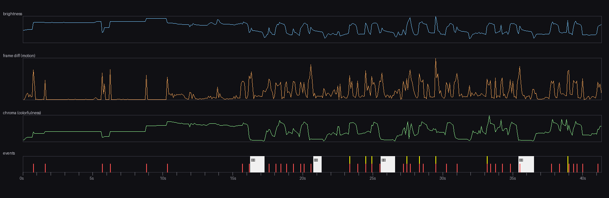

> 上图为量化时间轴：亮度（青）／帧间运动量（橙，即"打击强度"）／色彩饱和度（绿，**低谷=黑白立绘演出**）／事件带（白色块=立绘演出，黄线=闪白，红竖线=强打击）。

| # | 时间（视频） | 阶段 | 画面内容 | 对我们的意义 |
|:-:|-------------|------|----------|--------------|
| 1 | 0.0 – 2.3 s | 待机/进入 | 侠客大字立绘、顶部「至臻挑战！」、左下角出现"起点/擂台"元素 | 关卡入口的"仪式感"包装 |
| 2 | 2.3 – 3.3 s | 战前站位 | **地面空环形站位标记**（深色椭圆环）+ 双方角色**落位**入环 | 与九宫格布阵的"站位可视化"直接对应 |
| 3 | 3.3 – 6.7 s | 出战准备 | **阵法三选一**：龙吟虎啸阵（青龙纹/冰蓝）、五行八卦阵（太极/金）、天罡乾坤阵（星宿/橙）；每张带**熟练度 1500/1500** + 「选择」按钮；底部我方 6 人编队头像（Lv.100 / 已编队） | 我们的阵法系统需要同款"卡片 + 熟练度 + 纹章"表达 |
| 4 | 5.8 – 7.0 s | 开场 | 回到站位界面：中央金色「**VS**」书法 + 「开始挑战」按钮；左右各一枚阵法纹章 + 阵名 | VS 大字 + 阵纹章 = 低成本高辨识开场 |
| 5 | 7.0 – 16.2 s | 战斗 · 第 1 段 | 自动战斗；冰青地面 AoE（水系）、飘字；顶部出手队列条 + 「1/15」；左右竖排「龙吟虎啸阵」幡 | 稳定态战斗的基准画面 |
| 6 | **16.3 – 17.3 s** | **绝学①** | 立绘演出「**剑指月明**」（剑客，白袍） | 演出模板 A（角色中偏左 + 大字右） |
| 7 | 17.3 – 20.7 s | 战斗 · 第 2 段 | 群伤结算，屏幕漂白 + 「总伤害 924600」累计飘字 | 大数值 + 总伤害累计 = 爽感来源 |
| 8 | **20.7 – 21.5 s** | **绝学②** | 立绘演出「**行者无疆**」（蓝衣武僧/行者） | 演出模板复用（同构图、换角色与标题） |
| 9 | 23.3 / 24.5 / 24.9 s | 战斗 · 第 3 段 | 3 次闪白 + 刀光；「护盾 −460321」「怒气 +」飘字 | 闪白与刀光的密度基准 |
| 10 | **25.7 – 26.7 s** | **绝学③** | 立绘演出「**般若掌**」（黄衣老僧） | 3 字标题居中排布变体 |
| 11 | 27.4 – 29.5 s | 战斗 · 第 4 段 | 全屏**运动模糊 + 白闪**冲击帧、大字「**闪避**」、绿色刀气（外功） | **打击瞬间**的教科书式做法 |
| 12 | **31.0 – 32.0 s** | **绝学④** | 立绘演出「**禅武合一**」（金袍僧人，佛珠） | 唯一"彩色立绘占比高"的变体（黄袍），说明模板允许角色抢色 |
| 13 | 33.2 – 35.0 s | 战斗 · 第 5 段 | 闪白 + 龙形/兽形召唤特效 | 大型召唤物 = 全场焦点 |
| 14 | **35.4 – 36.5 s** | **绝学⑤** | 立绘演出「**青囊回春**」（持药草的医者 = 华佗） | 治疗型绝学共用同一演出模板 |
| 15 | 36.5 – 41.4 s | 战斗 · 收尾 | 持续高密度飘字；末帧可见「**总治疗 25944975**」「暴击 +4052297」（治疗暴击）「外功减伤」状态名 + 抖音直播 UI | 治疗也要有飘字/暴击反馈；状态名直接飘字 |

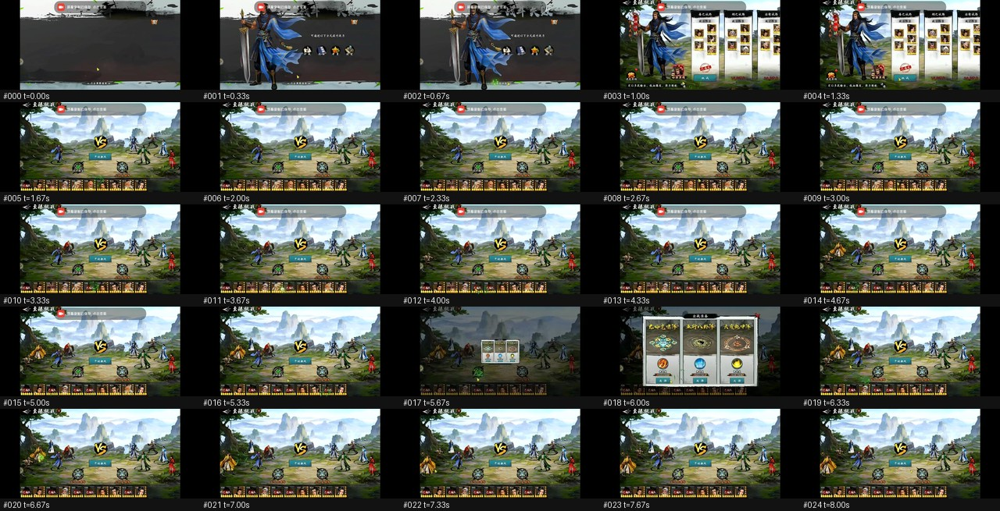
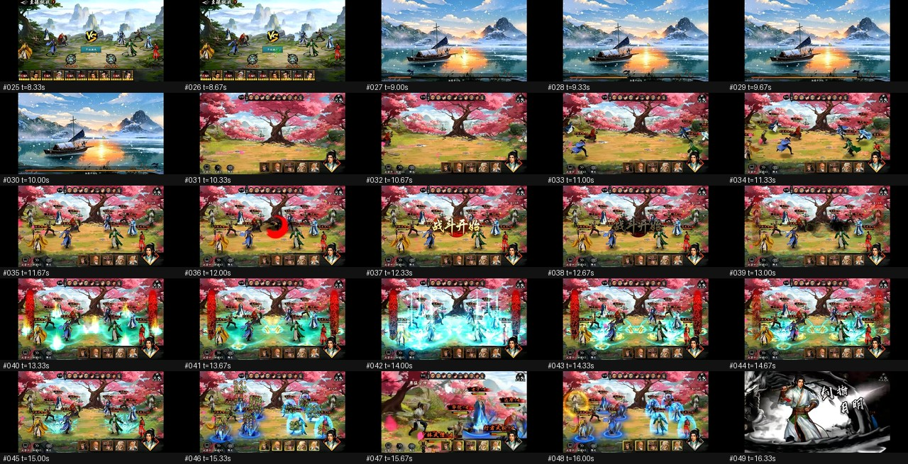

> 接触表每 5×5=25 帧（约 8.3 s）一张，格内标注帧号与时间（t）。全部 5 张见 `images/sheet_0*.jpg`。

---

## 3. 战斗演出风格拆解（9 个特征）

### 3.1 舞台：横版左右对峙 + 2.5D 手绘背景

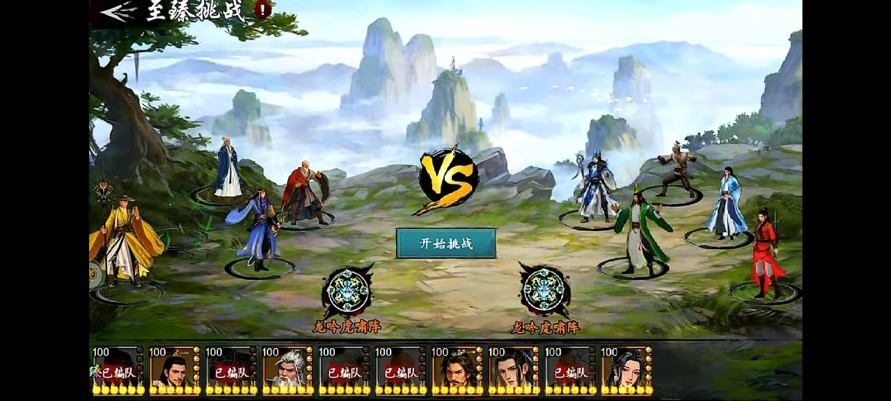

- **构图**：己方 6 人列于左侧 1/3，敌方 5–6 人列于右侧 1/3，**中央 1/3 留给"冲突"**（VS 字、阵法纹章、刀光路径）。
- **纵深**：同一侧的角色**前后错落 2 排**（近大远小），地面接触处有**深色椭圆环**（站位标记兼投影），不会出现"浮空"感。
- **背景分区**：上 45% 天空（云海/仙山/樱花树冠）+ 下 55% 地面（石台/草地），地面用**明度差**把角色"托"出来；战斗时背景带红色边缘光（阵幡/氛围）。
- **调色**：战前偏**天青 + 墨绿 + 岩金**（`#D8EDF9 / #2E311D / #968B5B`），战斗时注入高饱和元素色。战斗段平均亮度 0.338、平均饱和度 0.311、暖度 +0.056（**略偏暖**）。

### 3.2 战前：环形站位标记 + 阵法卡三选一

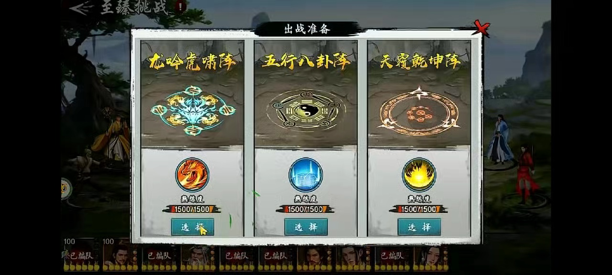

- 面板 = **宣纸/卷轴质感** + 黑色墨条标题「出战准备」+ 右上红色「✕」。
- 三张阵法卡**竖排并列**，每卡三层信息：**阵名（金色书法） → 阵法纹章（动态光效） → 熟练度条 1500/1500 + 「选择」按钮**。
- **纹章配色即阵营色**：青龙/冰蓝、太极/金、星宿/橙红。
- 底部为**我方编队头像条**（头像 + Lv + 「已编队」标签）。
- **对我们的直接价值**：这套"卡片 + 纹章 + 熟练度"的表达，可以直接翻译为我们 `阵法系统` 的战前界面（我们已有阵法数据，只缺表现）。

### 3.3 战中：托管 + 加速 X3 —— 玩家零操作

- 全程「**托管中**」：玩家不点任何技能，战斗完全自动。
- 「**加速X3**」：常态 3 倍速，是**自动战斗游戏的标准配置**（否则"看战斗"会变成负担）。
- 底部中央为**双方队伍头像条**（含血量/护盾状态、空位高亮）；右下为**当前行动角色的半身立绘**（菱形金框）——用"谁在出手"替代"技能条高亮"。
- **对我们的直接价值**：与 GDD `战斗方式.md`「战前排兵布阵，战中全自动」**完全同构**；我们应补上"**托管/加速**"以及"**当前行动者立绘**"两个表现件。

### 3.4 出手队列条 + 行动进度「1/15」

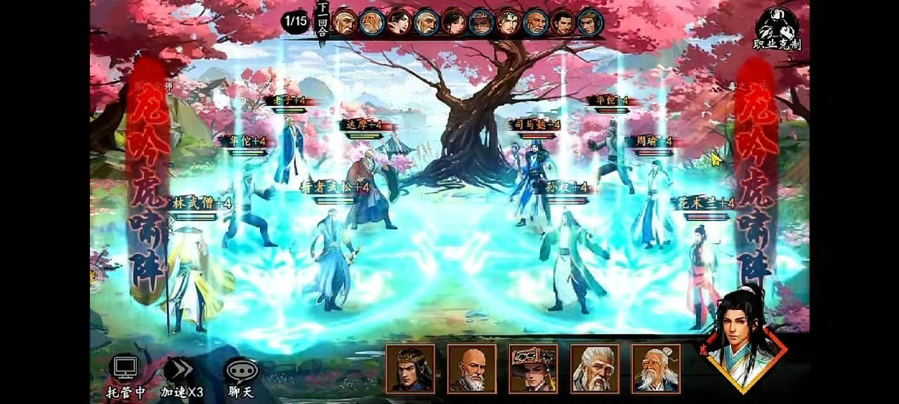

顶部细节（放大 2×，可见「1/15」+ 竖排「下一回合」+ 约 10 枚头像的出手队列 + 右上「职业克制」）：


- 顶部中央一条 **≈10 个头像的出手队列**（`下一回合` 竖排红字压在条上），左边圆形徽记显示「**1/15**」。
- 经逐帧核对：**「1/15」整场 33 s 不变**，因此它**不是回合计数**，更可能是「**本回合第 1 个行动者 / 全场共 15 个单位**」或关卡波次进度。
- 左右两侧竖排**阵名幡「龙吟虎啸阵」**（红底金/白字），随阵法变化 → **阵法在战斗中的持续可视化**。
- 右上「**职业克制**」徽标（三枚小图标）——开战前就把"职业相克"信息钉在 HUD 上。
- **对我们的直接价值**：我们要有「**出手顺序条**」（身法排序）与「**阵法在场可见**」，这两件能把"战前策略"在战中持续可见，避免玩家忘记自己布了什么阵。

### 3.5 ★ 核心记忆点：绝学立绘演出（本素材最值得抄的一件）

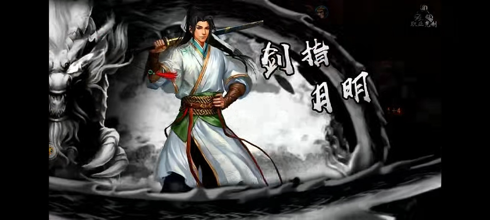
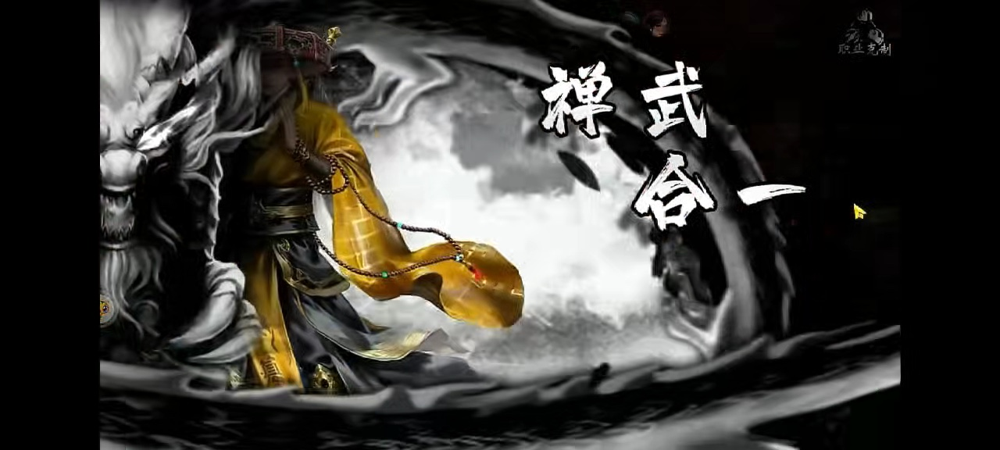

**5 次演出的标题排布对照**（同一模板，仅换角色与字形）：

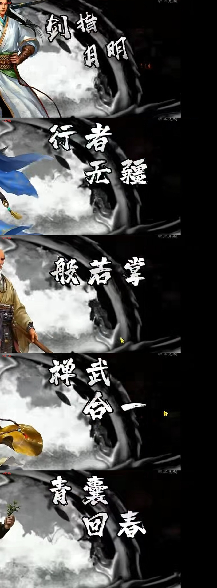

> 依次为：剑指月明（t=16.5 s） / 行者无疆（20.8 s） / 般若掌（25.9 s） / 禅武合一（31.2 s） / 青囊回春（35.8 s）。可见「4 字 2 行错落 + 3 字单行」两种排布、白色书法体、左墨龙 / 中角色 / 右标题的固定三角构图。

**模板（5 次演出完全同构）**：

| 层 | 内容 | 规格 |
|----|------|------|
| 底 | **黑白水墨云雾**（灰阶，飞白笔触），中心偏右留一块"宣纸白" | 彩度几乎为 0（实测立绘段饱和度 **0.152**，战斗段 0.318） |
| 纹 | **左侧巨型墨龙首**（或水墨环/云涡），压住画面左边缘 | 5 次演出**均出现**，构成系列识别符 |
| 主体 | **彩色角色立绘**，居左/中偏左，占屏高 70–90 %，保留角色原色（黄袍/白袍） | 全屏唯一彩色区域 |
| 字 | **白色书法大字**（功法名），**2 行错落排布**于右上，字号≈屏高 1/4，带轻微外发光/墨迹飞白 | 例：「剑指 / 月明」「行者 / 无疆」「般若掌」「禅武 / 合一」「青囊 / 回春」 |
| HUD | 原战斗 HUD（克制徽标、头像、飘字 `+4`）**不隐藏**，说明战斗在演出期间继续结算 | 演出是"叠层"，不是"切场" |

**节奏量化（视频时间）**：

| 指标 | 值 |
|------|-----|
| 出现次数 | **5 次**（16.3 / 20.7 / 25.7 / 31.0 / 35.4 s） |
| 单次时长 | 0.67 – 1.17 s，**均值 ≈1.0 s** |
| 间隔 | 4.4 / 5.0 / 5.3 / 4.4 s，**均值 4.78 s** |
| 占全片 | **≈12 %**（单场战斗 34 s 内 5 次） |
| 进入/退出 | 各 1 帧硬切（直方图差异突增 0.5–0.9），**没有推拉镜头、没有过渡** |
| 演出期间画面 | 饱和度骤降到 0.10–0.15，亮度降到 0.22（**压暗 + 抽色**） |

> **可抄点**：① 模板化（一次美术资源，N 个角色复用）；② 抽色到黑白，只留角色彩色 → 视觉聚焦极强、成本低；③ 硬切进出，不做过场 → 不打断自动战斗的流畅感；④ 演出作为"叠层"而不是"切场"，战斗数值继续滚动。
> **注意**：该素材是**直播展示**，密度偏高（每 5 s 一次）。我们的 4 人基准编队建议 **每场 2–4 次**，即"每 12–20 s 一次"。

### 3.6 VFX 语言：元素配色 + 地面环 + 刀光 + 召唤

从各阶段抽帧归纳出 6 类特效母题（可直接作为我们的特效词表）：

| 母题 | 形态 | 配色 | 用途推断 |
|------|------|------|----------|
| **地面 AoE 环** | 地面圆形/椭圆范围圈，内部水波/冰裂纹/藤蔓 | 冰青 `#C0EFEE`/`#61CDCD`、毒绿 | 群体伤害 / 控制（可作"攻击范围可视化"） |
| **弧形刀光** | 细长新月/抛物线拖尾，带 2–3 层叠加 | 青白、草绿 | 外功近战普攻/技能 |
| **元素爆发** | 角色中心向上喷发 + 地面裂开 | 火橙、雷紫、金 | 内功/爆发技 |
| **巨型召唤** | 龙/兽形半透明虚影横贯战场 | 金、橙 | 绝学本体（立绘演出之后落地的"大招"） |
| **全屏冲击** | 全屏白闪 + 径向/线性运动模糊 + 速度线 | 白 `#E4EDE3` | 命中瞬间（见 §3.7） |
| **墨迹/水墨** | 墨点扩散、飞白笔触、宣纸纹理 | 纯灰阶 | UI 边框、立绘演出、过场 |

**关键观察**：该作**用颜色代替文字**表达元素属性——蓝=冰/水、绿=毒/治疗、橙=火、紫=雷、金=圣/治疗。玩家不看数字也能读懂"这是什么技能"。

### 3.7 ★ 打击反馈三件套（"打击感"的实现方式）

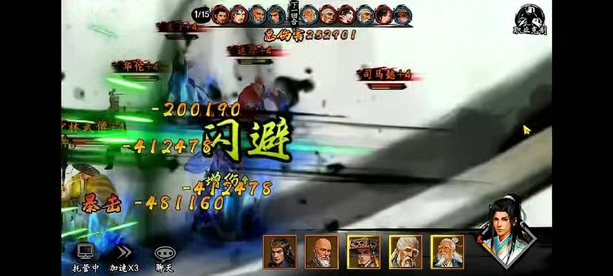

t=29.5 s 的一帧几乎全是**白色运动模糊 + 速度线 + 绿色刀气残余**，中央压着一枚巨大的黄色「**闪避**」，同时「暴击 −481160」等飘字浮在上层。归纳该作的打击反馈配方：

| 手段 | 观察到的做法 | 量化 |
|------|--------------|------|
| **全屏闪白** | 命中/爆发瞬间整屏提亮，1–2 帧 | 34 s 内 **8 次**（23.3 / 24.5 / 24.9 / 27.4 / 28.3 / 29.5 / 33.2 / 38.9 s），≈1 次 / 4.3 s |
| **运动模糊 + 速度线** | 冲击帧整屏模糊，方向与攻击方向一致 | 高运动帧占比 **18.7 %**，帧间差峰值 88/255（出现在 t=29.5 s） |
| **屏幕震动** | 强打击时整屏位移（在 12 fps 采样下表现为相邻帧差异突变） | 强打击 **38 次 / 34 s ≈ 1.11 次/s**（中位间隔 0.58 s） |
| **大字状态** | 「**闪避**」黄色巨型字、「**暴击**」红黄大字压在所有飘字之上 | 字号≈屏高 1/6，带描边 |
| **命中停顿** | 从演出帧序列看，重击后有 1–3 帧"信息静止" | 视频时间 ≈0.08–0.25 s |

### 3.8 飘字体系：把战斗日志"画"出来

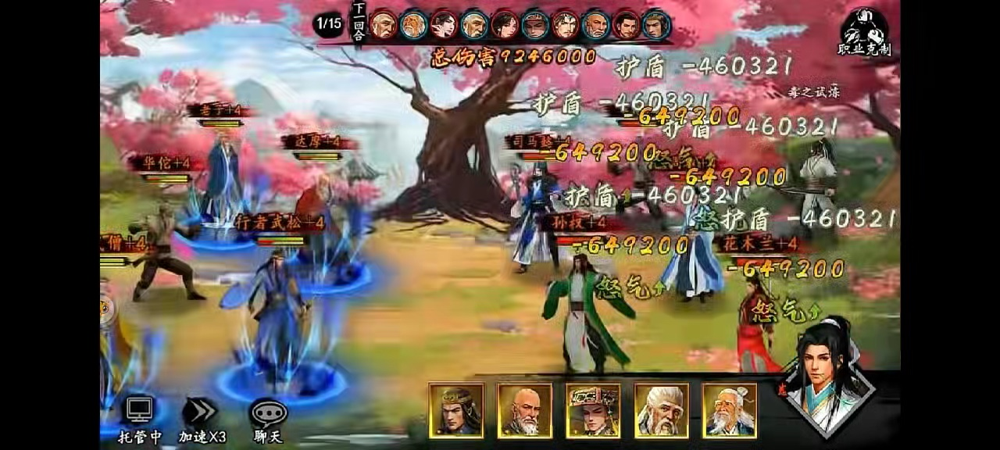

该作的飘字不是"伤害数字"，而是**完整战斗日志的视觉化**，共 8 类同屏共存：

| 类型 | 样式 | 实例 |
|------|------|------|
| 普通伤害 | 白色/浅黄，中等字号 | `−460321` |
| **暴击伤害** | **红黄大字 + 「暴击」前缀** | `暴击 −481160` |
| 闪避/未命中 | **黄色巨型字** | `闪避` |
| 治疗 | 绿色 | `+1736699`、`暴击 +4052297` |
| 护盾吸收 | 白字 + 「护盾」前缀 | `护盾 −460321` |
| 资源获取 | 红色小字 + 「+」 | `怒气 +` |
| **累计统计** | 金色大字，屏幕中上，长驻 | `总伤害 924600`、`总治疗 25944975` |
| **状态名** | 中字号文本直接飘出 | `外功减伤` |

**数值量级**：单次伤害 5–6 位（460,321 → 924,600），治疗/累计可达 8 位（25,944,975）。**这是刻意的"大数值爽感"**，与我们 GDD 的数值框架是否匹配需要单独评估（见 §5.2）。

### 3.9 HUD 布局与视觉优先级

```
┌─────────────────────────────────────────────────────────────┐
│ [1/15] [出手队列条 ≈10 头像] [下一回合]        [职业克制]     │ ← 顶部：回合/顺序/克制
│ ┌──┐                                                  ┌──┐  │
│ │阵│              主战场（角色 + 特效 + 飘字）          │阵│  │ ← 左右：阵名幡
│ │名│                                                  │名│  │
│ │幡│                                                  │幡│  │
│ └──┘                                                  └──┘  │
│        [托管中] [加速X3] [聊天]  [队伍头像条 5-6]  [行动者立绘] │ ← 底部：控制 + 队伍 + 当前行动者
└─────────────────────────────────────────────────────────────┘
```

- **中央 60 % 区域永不被 UI 侵占**（飘字除外）——所有信息都推到边缘。
- **半透明/水墨质感边框**，与 GDD `美术风格.md`「系统面板采用半透明设计，不遮挡画面」一致。
- **视觉优先级**（由高到低）：大字状态（闪避/暴击） > 绝学立绘 > 累计伤害 > 单次飘字 > 角色动作 > HUD。

---

## 4. 量化指标表（本报告全部结论的数据来源）

### 4.1 视频与画面

| 指标 | 值 |
|------|-----|
| 分辨率 / 帧率 / 时长 | 1280×576 / 24 fps / 41.417 s |
| 视频码率 / 音频 | ≈2 005 kbps HEVC；AAC mono 44.1 kHz 49 kbps |
| 战斗段平均亮度 | 0.338（p10 0.192 / p90 0.479） |
| 战斗段平均饱和度 | 0.311（p10 0.136 / p90 0.386） |
| 暖度（(R−B)/Σ） | +0.056（p10 −0.051 / p90 +0.161）→ 略偏暖 |
| 边缘密度（细节量） | 22.5（p10 14.8 / p90 29.1） |
| **立绘演出段 vs 战斗段** | 饱和度 **0.152 vs 0.318**；亮度 **0.228 vs 0.364** |

### 4.2 运动与演出节奏

| 指标 | 值 |
|------|-----|
| 帧间运动量（均值 / p90 / 峰值） | 13.4 / 39.0 / **88.4**（峰值在 t=29.5 s） |
| 高运动帧占比 | **18.7 %** |
| 强打击次数（战斗段 34 s） | **38 次 ≈ 1.11 次/s**；间隔 中位 0.58 s / 均值 0.87 s / p90 1.87 s |
| 视觉节拍（自相关） | **0.58 s（≈103 BPM）** |
| 闪白次数（战斗段） | 8 次 ≈ 1 次 / 4.3 s |
| 绝学演出 | 5 次，单次 ≈1.0 s，间隔 4.78 s，覆盖率 ≈12 % |

### 4.3 音频

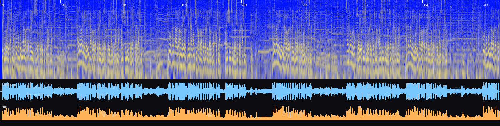

| 指标 | 值 | 解读 |
|------|-----|------|
| 峰值 / 平均电平 | −0.09 dBFS / −19.5 dBFS | 混音较满，动态被压 |
| 响度范围（p5–p95） | −26.7 ~ −12.3 dBFS | 段落起伏约 14 dB |
| 频谱质心（均值） | 1 453 Hz（p10 792 / p90 2 249） | 偏暗、偏厚 |
| 85 % 滚降频率 | 2 964 Hz | 高频信息少（移动端喇叭友好） |
| 频段能量 | <150 Hz **17.4 %** ｜ 150–400 **28.1 %** ｜ 400–1 k **23.4 %** ｜ 1–2.5 k 10.8 % ｜ 2.5–5 k 10.4 % ｜ 5–11 k 9.9 % | **68.9 % 在 1 kHz 以下** |
| 起音（onset） | 145 次，**3.5 次/s** | 打击音效 + 鼓点密集 |
| BPM 估计 | **130.5**（周期分 0.066，较弱） | 与视觉节拍 103 BPM 不同源，说明"视觉节奏≠音乐节奏" |
| 起音间隔（IOI）峰值 | **0.10–0.25 s**（另见 0.5 s） | 16 分音符网格（0.115 s @130 BPM） |
| 调性倾向 | chroma 最强 A/F/C/D；五声（C D E G A）占 **55.2 %** | 与"古风"配器一致（证据中等） |
| **BGM 留白窗口** | 约 4.5–5.5 / 12–13 / 21–23 / 26–28.5 / 37–40 s，长约 0.5–2.5 s，**每 5–8 s 一次** | **音乐主动降层，给打击音效/绝学让位** |

### 4.4 色板（K-means 提取，可直接作为我们的阶段调色基准）

| 场景 | 主色（占比） |
|------|--------------|
| 战前布阵 | `#D8EDF9` 天青(23 %) ｜ `#020201` 墨黑(23 %) ｜ `#2E311D` 墨绿(20 %) ｜ `#5D6149` 苔绿(16 %) ｜ `#968B5B` 岩金(10 %) |
| 战斗中（樱花庭院） | `#070504` 墨黑(27 %) ｜ `#C0EFEE` 冰青(22 %) ｜ `#414B4B` 灰绿(15 %) ｜ `#AC8688` 粉灰(14 %) ｜ `#61CDCD` 青碧(13 %) ｜ `#902F33` 暗绯(9 %) |
| 飘字爆发 | `#040403` ｜ `#B98F71` 暖褐 ｜ `#876349` ｜ `#473A32` ｜ `#C4CDD5` 冷灰 |
| **绝学立绘** | `#030202` 墨黑(49 %) ｜ `#23211F` ｜ `#757472` ｜ `#4A4643` ｜ `#A4A6A6` ｜ `#E2E5E3` 宣纸白 |
| 全屏冲击 | `#040606` ｜ `#353D33` ｜ **`#E4EDE3` 白光(21 %)** ｜ `#767354` ｜ `#9CAA98` |
| 阵法面板 | `#040402` 墨黑(35 %) ｜ `#5D665F` ｜ `#C1C8C3` 宣纸(15 %) ｜ `#494638` ｜ `#26251C` |

---

## 5. 与《江湖从心》现有设计的对齐分析

**对照文档**：`05_combat/战斗方式.md`、`05_combat/连招系统.md`、`09_art_ui/美术风格.md`、`09_art_ui/音乐音效.md`、`jianghu-game/README.md`（技术栈与五条架构铁律）

### 5.1 已经一致 —— 可以直接强化

| 我们的设计 | 参考视频的做法 | 结论 |
|------------|----------------|------|
| 战前排兵布阵、**战中全自动** | 全程「托管中」，玩家零操作 | ✅ 同构。补「托管/加速」表现件即可 |
| **左右对峙**、己方左敌方右 | 完全一致 | ✅ 可直接沿用其构图比例 |
| **阵法系统** | 阵法三选一 + 战中阵名幡 + 阵法纹章 | ✅ 我们缺表现，正好照抄"卡 + 纹章 + 熟练度 + 场上幡" |
| **身法决定出手顺序** | 顶部出手队列条 + 「下一回合」 | ✅ 我们要把"身法顺序"做成同款队列条 |
| **2.5D 斜视角 + 水墨江湖风** | 手绘背景 + 水墨 UI + 黑白立绘演出 | ✅ 审美同向，可直接对标 |
| **连招 · 起势/收势** | 绝学演出 = 招式的高光时刻 | ⭐ 我们的"起势/收势"就是天然的演出触发点 |
| **战斗预结算 + 表现分离** | 立绘演出期间战斗数值继续滚动（HUD 飘字照旧） | ⭐ 说明演出可以做成**纯叠层**，不阻塞结算 |

### 5.2 冲突点与处理建议

| 冲突 | 说明 | 建议 |
|------|------|------|
| **怒气 / 大招已移除** | 视频中是「怒气」驱动绝学；我们 `战斗方式.md` 明确"原怒气/大招机制已移除，若要恢复需另定积攒资源" | **不要为了演出复活怒气**。用**已有资源**承载演出触发：① 连招三连成功（威力 +60 % + 吸血）→ 触发"收势演出"；② 单场一次的"功法境界突破/绝境反杀"；③ 内力消耗达阈值。**演出触发的判定条件写进战斗日志，表现层只读日志** |
| **数值量级** | 视频单次 46 万 – 92 万、累计 2 500 万，属"买量式膨胀" | 我们走**叙事向开放世界 RPG**，建议飘字保留"暴击/闪避/护盾/状态名"等信息分层，但**数值保持可读量级**（3–5 位），累计统计做成可选开关 |
| **编队规模** | 视频 6 人 vs 6 人 | 我们 3→4→5 人（门派战 6）。演出槽位需按 `min(我方人数, 4)` 设计，避免 3 人编队时演出过密 |
| **时长口径** | 视频 3× 加速 | 所有时长按 §1.3 换算后**重新定标**（见 §6.2） |

### 5.3 架构落地：演出必须是"表现层事件"

按项目铁律「**战斗预结算与表现分离**」，绝学演出必须满足：

1. **结算阶段**：预结算只输出 `BattleLog` 事件（如 `combo_finish{level:3, skillId, actorId, targetIds}`），**不含任何演出字段**。
2. **表现阶段**：表现层把 `combo_finish.level>=2` 映射为一次立绘演出（**是否演出、演多久，都不影响结算结果**）。
3. **零硬编码**：演出的时长/镜头/颜色/飘字样式全部来自数据表（建议 `data/tables/combat_feel.csv`），代码只读表。
4. **可回放**：因为演出由日志驱动，录像/重放/加速/跳过都能自然工作（跳过 = 表现层直接消费下一条日志）。

---

## 6. 落地规范 v0.1（可直接执行）

> 说明：**所有时长均为"实时"口径**（= 视频时间 × 3 后重新按手游手感定标），与 §4 的视频口径区分。参数写成表，建议落到 `data/tables/combat_feel.csv`。

### 6.1 舞台与镜头规范

| 项 | 规范 |
|----|------|
| 基准分辨率 | 逻辑 1920×1080（16:9 安全区），主战场区域中线左右各 640 px |
| 站位 | 己方左 1/3、敌方右 1/3，各 2 排错落（前排 y+0，后排 y−48，缩放 0.92） |
| 中央留白 | 中央 1/3（x 640–1280）**禁止常驻 UI**，仅允许临时演出/飘字 |
| 地面标记 | 每格一个**深色椭圆环**（alpha 0.35，宽 96×36），入位时 0.3 s 缩放弹出 |
| 背景 | 上 45 % 天空 / 下 55 % 地面；战斗时叠加左右**阵幡**（宽 72 px，半透明 0.85） |
| 相机 | 基准固定；仅"全屏冲击"时叠加 shake（见 §6.3），**不做推拉**（省成本 + 保可读性） |

### 6.2 时长表（实时秒）

| 事件 | 时长 | 备注 |
|------|------|------|
| 普攻 | 0.6 – 0.8 s | 可 1.5× 速播 |
| 主动招式 | 1.0 – 1.5 s | 含起势 0.2 s + 命中 + 收势 0.3 s |
| **绝学立绘演出** | **1.2 – 1.6 s** | 入场 0.12 s 淡入 → 保持 1.0 s → 出场 0.15 s 淡出（**允许硬切变体**） |
| 立绘演出后的技能落地 | 0.8 – 1.2 s | 龙形/元素爆发出现在战场 |
| 命中停顿（hitstop） | 0.06 – 0.12 s（重击 0.15 s） | 只冻结角色与特效，不冻结飘字/UI |
| 全屏闪白 | 0.06 – 0.10 s | 白 alpha 0.55 → 0 |
| 震屏 | 0.10 – 0.25 s | 幅度 4–12 px，重击 16 px |
| 飘字生命周期 | 0.8 – 1.2 s（累计统计 1.6 s） | — |
| 战斗总时长（目标） | 45 – 90 s / 场 | 对应视频 34 s ×3 ≈102 s，我们取更短 |

### 6.3 打击感参数表

| 参数 | 轻击 | 重击 | 绝学/暴击 |
|------|:----:|:----:|:---------:|
| hitstop（ms） | 60 | 100 | 150 |
| 震屏幅度（px） | 3 | 8 | 16 |
| 震屏时长（ms） | 100 | 160 | 250 |
| 闪白 alpha | 0.15 | 0.35 | 0.55 |
| 闪白时长（ms） | 60 | 80 | 100 |
| 刀光存活（ms） | 120 | 220 | 400 |
| 刀光层数 | 1 | 2 | 3 |
| 粒子预算（同屏） | 60 | 150 | 300（移动端上限 400） |
| 运动模糊 | 无 | 局部拖尾 | 全屏 0.12 s（可关） |
| 状态大字（暴击/闪避） | — | 字号 96 | 字号 128 + 缩放弹入 |

> **移动端提醒**：视频那种"全屏运动模糊"对 GPU 代价高且在小屏收益有限，建议做成**开关**（默认关闭，PC 开启）。

### 6.4 ★ 绝学立绘演出规范

**触发规则（建议）**

| 触发源 | 条件 | 是否演出 | 频率上限 |
|--------|------|:--------:|----------|
| 连招二连 | 收势=起势，威力 +30 % | 否（只做强化刀光） | — |
| **连招三连** | 三连成功、威力 +60 %、吸血 | **是** | 每场每人 ≤1 次 |
| 辅助型套路 | 插入连招链中断 | 否 | — |
| 战局转折 | 己方首名角色倒下 / 敌方 BOSS 血量跨 30 % | 是（复用模板） | 每场 ≤1 次 |
| **单场总预算** | — | — | **2 – 4 次 / 场**，两次之间 ≥10 s |

**模板分层（照抄其结构，重画素材）**

```
Layer 0  背景：黑白水墨云雾 + 飞白笔触（彩度≈0，亮度 0.22）
Layer 1  纹样：左侧墨龙首 / 水墨环（固定识别符，5 次演出必现）
Layer 2  主体：角色彩色立绘，占屏高 70–90%，居左或中偏左
Layer 3  标题：功法名，白色书法体，2 行错落（4 字）或 1 行（3 字），
                字号≈屏高 1/4，轻微外发光 + 墨迹飞白
Layer 4  HUD：原战斗 HUD 保持可见（克制徽标/队列条不变）
Layer 5  叠字：演出期间战斗飘字继续滚动（证明"这不是切场"）
```

**实现要点**

- **抽色**：背景层统一走 `#030202 → #E2E5E3` 灰阶；仅角色立绘保留彩色。
- **一次资源 N 复用**：背景/纹样/排版做 1 套（+2 变体配色），角色立绘按 `功法 id` 换图即可。
- **必须可跳过**：设置项「绝学演出：完整 / 简短 / 关闭」；加速 X2/X3 时演出自动切「简短」（0.6 s 纯标题闪入）。
- **不得阻塞结算**：演出期间战斗日志继续消费，伤害在演出结束的同一帧结算并飘字（与视频一致）。

### 6.5 飘字规范

| 类型 | 颜色 | 字号（1080p） | 存活 | 飘动 |
|------|------|:-------------:|:----:|------|
| 普通伤害 | `#FFF3D6` 米白 | 34 | 0.8 s | 上抛 40 px + 轻微右偏 |
| 暴击伤害 | `#FFD24A` 金 + `#C8362B` 描边 | 48 + 「暴击」标 | 1.0 s | 上抛 56 px + 首帧缩放 1.4→1.0 |
| 闪避 | `#FFE066` | 64 | 0.9 s | 原地弹入 + 淡出 |
| 治疗 | `#7CE08A` 绿 | 34 | 0.9 s | 上抛 + 上升气流粒子 |
| 护盾吸收 | `#CFE8FF` 冷白 + 「护盾」 | 30 | 0.7 s | 上抛 |
| 状态名（如"外功减伤"） | `#E8E8E8` | 30 | 1.0 s | 跟随角色头顶 |
| 累计统计（总伤害/总治疗） | `#FFD24A` | 44 | 1.6 s | 屏幕中上长驻，覆盖刷新 |
| **同屏规则** | 同一目标 0.25 s 内多次命中**合并**为一个数字（跳动累加） | | | |

### 6.6 色板（建议纳入 `09_art_ui` 色板）

| 用途 | 色值 | 来源 |
|------|------|------|
| 墨黑（UI/立绘底） | `#030202` / `#070504` | 实测主色 |
| 宣纸白（立绘高光/大字） | `#E2E5E3` / `#F2F0EA` | 实测 |
| 天青（战前/天空） | `#D8EDF9` | 实测 |
| 冰青（水系/控制 AoE） | `#C0EFEE` / `#61CDCD` | 实测 |
| 苔绿 / 墨绿（地形） | `#2E311D` / `#5D6149` | 实测 |
| 岩金（阵法/书法） | `#968B5B` / `#FFD24A` | 实测 + 飘字 |
| 暗绯（阵幡/边缘光） | `#902F33` | 实测 |
| 毒绿 / 治疗绿 | `#7CE08A` / `#5FBF6A` | 观察归纳 |
| 火橙 / 雷紫 | `#E8792B` / `#8E5BD6` | 观察归纳 |

### 6.7 音频规范

| 项 | 规范 |
|----|------|
| BGM（战斗） | 古风 100–130 BPM；**鼓点 + 二胡 + 琵琶**（与 `音乐音效.md` 一致）；**鼓点落在强拍，留出 1/16 空隙给打击音效** |
| **BGM 留白** | 每次绝学演出前 0.3 s 起，BGM 降 6–8 dB 或做 0.5–1.5 s 留白，突出打击音效（**这是参考视频最值得学的音频手法**） |
| 混音重心 | 能量集中在 1 kHz 以下（视频实测 68.9 %），移动端喇叭友好；高频只保留"刀光/金属"的 3–6 kHz 点缀 |
| 打击音效分层 | 轻击（布料/风声 + 低频 thump）/ 重击（金属 + 80–150 Hz 冲击）/ 暴击（加 1 层金属谐波 + 短混响） |
| 绝学音效 | 立绘入场用"毛笔/纸张"质感 + 一记大锣/鼓；落地用元素音 + 低频冲击 |
| 加速策略 | X2/X3 时**只加速战斗动作与音效**，BGM 保持原速原调（参考视频即如此）；绝学演出音效跟随演出模式（简短模式只保留"入声"） |

### 6.8 性能预算（移动端）

| 项 | 预算 |
|----|------|
| 同屏角色 | ≤12（含召唤）|
| 同屏粒子 | ≤400 |
| 全屏后处理 | 闪白（全屏纯色插值）默认开；**运动模糊默认关** |
| 立绘演出 | 1 张立绘 + 1 张背景 + 1 个标题字形（图集），预加载 |
| 飘字 | 对象池 ≥64；同屏显示上限 24（超出合并） |
| 目标帧率 | 30 fps 起（低端机）/ 60 fps（高端机） |

---

## 7. 风险与红线

| 风险 | 说明 | 对策 |
|------|------|------|
| **演出疲劳** | 视频每 5 s 一次演出是"买量素材"密度，长期游玩会烦 | 单场 2–4 次 + 可跳过 + 加速时自动简短 |
| **时长口径误用** | 直接照抄 1.0 s 会"短促"，照抄 3.0 s 会"拖沓" | 统一按 §6.2 的实时口径 |
| **数值膨胀** | 8 位数累计会破坏叙事向 RPG 的代入感 | 保留信息分层，数值维持可读量级 |
| **运动模糊/全屏后处理** | 移动端 GPU 与可读性双输 | 做成画质开关，默认关 |
| **授权红线** | 本素材为商业游戏直播录屏，其中的立绘/纹章/书法字形均为他人资产 | **只学方法（模板/节奏/配色/信息分层），不提取任何像素**；正式美术全部自绘（参考库 `README.md` 红线） |
| **来源未确证** | 疑似作品未 100 % 确认 | 已按"仅参考 + 来源未知"标注 |

---

## 8. 验收清单（可勾选）

- [ ] 战前：阵法卡（阵名 + 纹章 + 熟练度 + 选择）表现完成，进入战斗后左右阵幡正确显示
- [ ] 战中：顶部出手队列条随身法排序刷新，「下一回合」标记正确
- [ ] 战中：托管 / 加速 X1·X2·X3 三档可用，加速不影响 BGM 速度与调性
- [ ] 绝学演出：模板 5 层齐全（水墨底 / 墨龙纹 / 彩立绘 / 书法大字 / HUD 叠层）
- [ ] 绝学演出：由 `BattleLog` 的连招段数驱动，**结算结果与是否演出无关**（构造用例验证）
- [ ] 绝学演出：可跳过、可切"简短模式"、单场次数 ≤4
- [ ] 打击反馈：hitstop / 震屏 / 闪白 / 刀光 参数来自 `combat_feel.csv`，改表即生效
- [ ] 飘字：8 类飘字齐全，同目标 0.25 s 合并规则生效
- [ ] 音频：绝学前 BGM 留白/降层生效；打击音效三档分层
- [ ] 性能：同屏粒子 ≤400、飘字对象池生效、低端机 30 fps 稳定
- [ ] 合规：**未使用参考素材的任何像素/音频**，全部资产自绘/自制

---

## 9. 附录

### 9.1 本报告产物清单

| 路径 | 内容 |
|------|------|
| `战斗演出风格分析报告.md` | 本报告 |
| `images/timeline.png` | 量化时间轴（亮度/运动/饱和度/事件） |
| `images/sheet_00..04.jpg` | 全片接触表（5×5 帧 / 张，含时间戳） |
| `images/key_*.jpg` | 8 张关键帧全分辨率截图（战前/阵法/战斗 HUD/飘字/冲击/立绘×2） |
| `images/spectrogram.png` | 音频频谱图 + 波形 + RMS |
| `测量数据/frame_metrics.json` | 逐帧亮度/饱和/边缘/暖度/帧差 |
| `测量数据/motion.json` | 打击峰值、闪白、立绘演出区间、节拍 |
| `测量数据/audio.json` | 响度/起音/BPM/频谱/静音段 |
| `测量数据/shots.json` | 镜头切分 |
| `测量数据/palette.json` | 各场景 K-means 色板 |
| `落地草案/combat_feel.csv` | **打击感参数表草稿**（hitstop/震屏/闪白/刀光/粒子，按事件分行，可直接搬进 `jianghu-game/data/tables/`） |
| `落地草案/cutin_ultimate.csv` | **绝学立绘演出配置草稿**（模板/时长/分层/跳过/冷却） |

### 9.2 复现命令

```bash
cd jianghu-tools/video-analysis
# 1) 编译原生探测工具（无需 ffmpeg）
clang -fobjc-arc -fmodules-cache-path=./build/modulecache -o build/vprobe vprobe.m \
  -framework Foundation -framework AVFoundation -framework CoreMedia \
  -framework CoreGraphics -framework AppKit
# 2) 探测
./build/vprobe info  "../../jianghu-references/06_audio/aace9399c88a658bbbb1b4d78e2c9da5.mp4"
# 3) 抽帧（3fps 概览 / 12fps 运动分析 / 指定时刻全分辨率）
./build/vprobe range <video> out/frames_3fps  0 41.4 3  640 0
./build/vprobe range <video> out/frames_12fps 0 41.4 12 320 0
./build/vprobe range <video> out/frames_full  16.5 16.5 1 1280 1
# 4) 抽音频
./build/vprobe pcm <video> out/audio_22050.raw 22050
# 5) 分析（PY = 项目自带 python）
$PY analyze_frames.py out/frames_3fps  out/analysis
$PY analyze_motion.py out/frames_12fps out/analysis
$PY analyze_audio.py  out/audio_22050.raw 22050 out/analysis/audio.json
$PY spectrogram.py    out/audio_22050.raw 22050 out/analysis/spectrogram.png
```

### 9.3 全片接触表（其余 3 张）

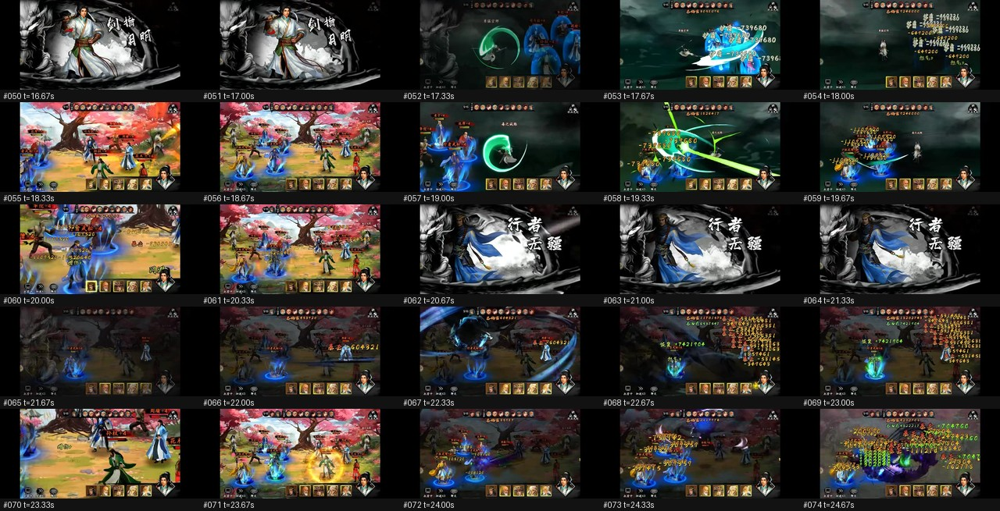
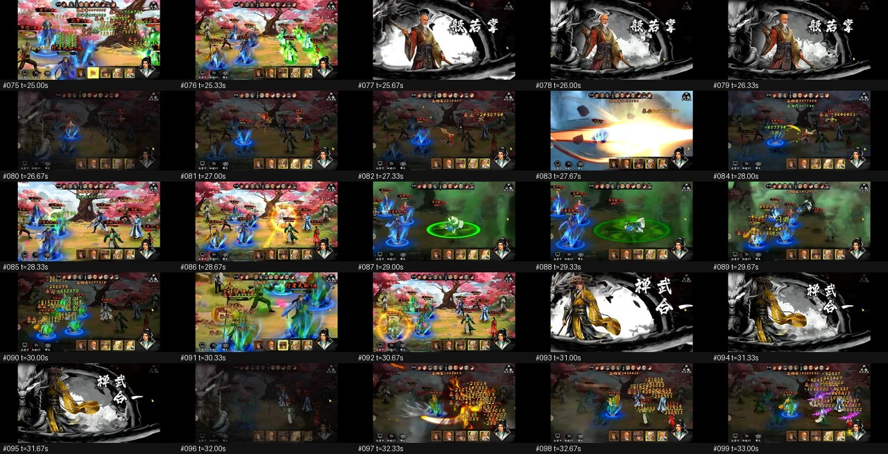
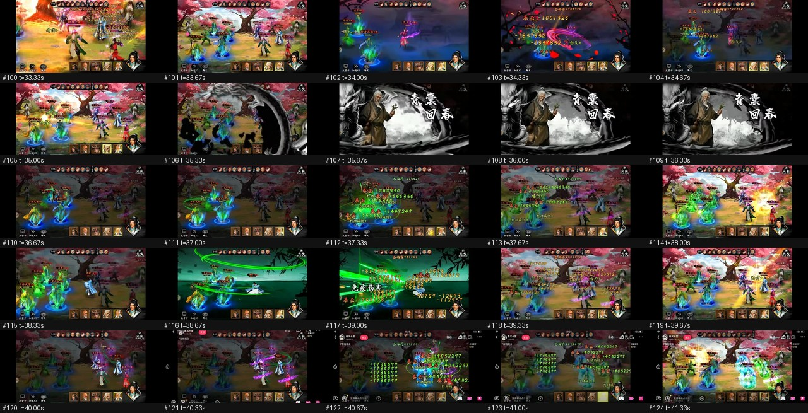

### 9.4 参考链接（外部，仅用于作品辨识）

- [新射雕群侠传阵法怎么选（9game）](https://www.9game.cn/shediao/11039958.html)
- [新射雕群侠传之铁血丹心 试练塔阵法激活方法](https://www.doyo.cn/news/130909.html)
- [《新射鵰群俠傳》官方网站（跨世代武侠卡牌 RPG）](http://xsdqxzhw.cmge.com/index/detail/id/46)

---

_报告结束。所有时长/频率若未特别标注，均为**视频时间**；落地参数（§6）已换算为**实时**。_
